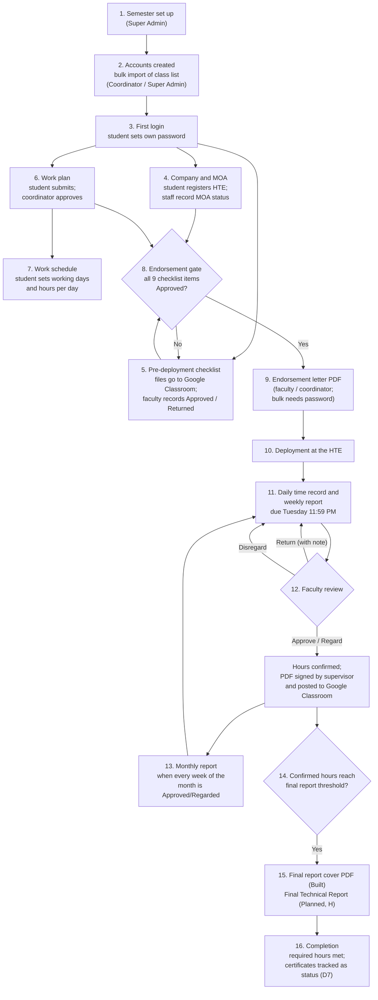

# 02. The internship lifecycle in IDSMS

_Last updated: 12 October 2026. Status labels: **Built**, **In progress**, **Planned** (see the [index](README.md))._

This document follows one student from account creation to completion and shows who does what at each step. The rules behind each step are listed in [07. Business rules](07-business-rules.md).

## 1. The journey at a glance

Steps 11 and 12 change when **Workstream L1 (In progress)** ships: the daily time record gets two time ranges per day, overtime, undertime and leave become requests the faculty approves, and hours follow SLU's credited-hours rules. See section 3.

## 2. Step by step

### Before deployment

| Step | What happens                                                                                                                                                                                                                                                                                                                                                         | Who                                                                             | Status                                                                                                              |
| ---- | -------------------------------------------------------------------------------------------------------------------------------------------------------------------------------------------------------------------------------------------------------------------------------------------------------------------------------------------------------------------- | ------------------------------------------------------------------------------- | ------------------------------------------------------------------------------------------------------------------- |
| 1    | **Semester set up.** A semester (name, academic year, start and end dates) is created and made active. Only one semester is active at a time.                                                                                                                                                                                                                        | Super Admin                                                                     | **Built**                                                                                                           |
| 2    | **Accounts created.** The class list (student number, email, program, required hours) is uploaded as CSV or Excel for a chosen class group and semester. Each student gets a default password and the 9 checklist items are created. The default password is shown once to the person who imported it, never emailed.                                                | Coordinator or Super Admin                                                      | **Built**                                                                                                           |
| 3    | **First login.** The student signs in with the school email and default password and must set a new password before using anything else. They should also enter their legal name on the Profile page (needed on letters and reports).                                                                                                                                | Student                                                                         | **Built**                                                                                                           |
| 4    | **Company and MOA.** The student registers their host company (name, address, work modality, supervisor). Staff add the MOA record (status, validity dates, programs covered) and move it through its stages until "Approved / Active". Staff can mark the company as verified.                                                                                      | Student; faculty, coordinator or Super Admin                                    | **Built**. MOA without upload, foreign HTE flag: **Planned**                                                        |
| 5    | **Pre-deployment checklist.** The student submits each document (medical certificate, psychological clearance, parent's consent, etc.) **in Google Classroom**, not in IDSMS. Faculty record each item as Approved or Returned (a note is required when returning). Work Plan and MOA items can only be approved once the underlying work plan and MOA are approved. | Student (Google Classroom); faculty adviser, coordinator or Super Admin (IDSMS) | **Built** (status-only, D7)                                                                                         |
| 6    | **Work plan.** The student submits planned tasks. The coordinator approves or returns it with feedback. An approved plan is locked; changes need a new submission.                                                                                                                                                                                                   | Student; coordinator or Super Admin                                             | **Built**                                                                                                           |
| 7    | **Work schedule.** After approval, the student sets working days and hours per day. Philippine holidays are pre-loaded; the student can mark which apply.                                                                                                                                                                                                            | Student                                                                         | **Built**. Shift start/end and lunch break: **In progress** (L1)                                                    |
| 8    | **Endorsement gate.** IDSMS blocks the endorsement letter until all 9 checklist items are Approved.                                                                                                                                                                                                                                                                  | System                                                                          | **Built**. Required/optional items and the per-student "allowed to start before MOA approval" override: **Planned** |
| 9    | **Endorsement letter.** A PDF with a reference code (EL-…) is generated for one student, or for a whole class group in bulk (bulk needs the staff member's password). The student is notified.                                                                                                                                                                       | Faculty adviser, coordinator or Super Admin                                     | **Built**                                                                                                           |

### During deployment

| Step | What happens                                                                                                                                                                                                                                                                                                                                                                                                                                         | Who                                                 | Status                                                               |
| ---- | ---------------------------------------------------------------------------------------------------------------------------------------------------------------------------------------------------------------------------------------------------------------------------------------------------------------------------------------------------------------------------------------------------------------------------------------------------- | --------------------------------------------------- | -------------------------------------------------------------------- |
| 10   | **Deployment.** The student starts at the HTE.                                                                                                                                                                                                                                                                                                                                                                                                       | Student                                             | —                                                                    |
| 11   | **Daily time record and weekly report.** For each week (Monday to Sunday) the student opens a report that lists their scheduled days. For each day they choose Present, Absent or Holiday, enter time in/out, hours and accomplishments. They submit by **Tuesday 11:59 PM (Manila)** of the following week. Late submissions require a reason for delay. A reference code (WR-…) is assigned. Reminders arrive 48 and 24 hours before the deadline. | Student                                             | **Built**                                                            |
| 11a  | **Deviations.** Absences, overtime and undertime are reported with a reason (and, today, an optional proof upload) and validated by staff. L1 proposes replacing deviation proof uploads with status-only requests (proof in Google Classroom); pending confirmation (Q19). Today students can still upload a proof file.                                                                                                                            | Student; faculty or staff                           | **Built**. Replaced by Leave & Time Requests in L1 (**In progress**) |
| 12   | **Faculty review.** The adviser opens the report and chooses Approve, Return (note required), Regard or Disregard. Approved and Regarded weeks become **confirmed hours**; submitted weeks waiting for review show as **pending hours**. The student downloads the PDF, has the supervisor sign it, and posts the signed copy in Google Classroom (D2).                                                                                              | Faculty adviser; student; HTE supervisor (on paper) | **Built**                                                            |
| 12a  | **Schedule change (if needed).** The student requests a new schedule with a reason. The adviser validates it, then the coordinator gives final approval. It applies from then on and never changes past approved hours.                                                                                                                                                                                                                              | Student; faculty; coordinator                       | **Built**                                                            |
| 13   | **Monthly report.** For a calendar month, once every weekly report in it is Approved or Regarded, the student submits the monthly report and a PDF (MR-…) is produced.                                                                                                                                                                                                                                                                               | Student                                             | **Built**. SLU monthly journal template: to confirm (Q7)             |

### After deployment

| Step | What happens                                                                                                                                                                                                               | Who                  | Status                                                                            |
| ---- | -------------------------------------------------------------------------------------------------------------------------------------------------------------------------------------------------------------------------- | -------------------- | --------------------------------------------------------------------------------- |
| 14   | **Final report threshold.** When confirmed hours reach the threshold (default: 500 for BSIT; five-sixths of required hours for other programs, never above the student's required hours), the final report cover unlocks.  | System               | **Built**                                                                         |
| 15   | **Final report.** The student generates the final report cover PDF (FC-…). The Final Technical Report itself (company profile, evaluation scores, proof), its coordinator review and the HTE evaluation are not built yet. | Student; coordinator | Cover **Built**. Report, HTE evaluation, certificates: **Planned** (Workstream H) |
| 16   | **Completion.** The student reaches required hours (shown as "Completed" on dashboards). Post-internship certificates (Attendance from the CPO, Completion from the HTE) are tracked as status only under D7.              | Student; staff       | Hours and status **Built**; certificate tracking **Planned** (H)                  |

## 3. What changes with Workstream L1 (In progress)

The following is designed and approved but **not available yet**:

- **Leave & Time Requests tab** (students): file leave (planned or emergency, full or partial day), overtime and undertime requests, each with a reason. Faculty approve or return them with a note. Proposed (pending confirmation, Q19): proof stays in Google Classroom.
- **Two time ranges per day** (morning and afternoon) in the daily time record, and a per-student shift (start, end, lunch break; default 8:00–5:00 with 1 hour).
- **SLU credited-hours rules:** only time inside the shift counts; time outside counts only as approved overtime of at least 30 minutes; no offsetting on a late day; tardiness and early leave become undertime that needs a reason before the week can be submitted.
- **SLU Weekly Work Report layout** for the preview and PDF, including the "Report on Overtime Hours" and "Report on Under Time Hours" sections signed by the supervisor.
- **Week numbers** based on a "Week 1 starts" date per semester.

The rules and worked examples are in [07. Business rules](07-business-rules.md), section 4.

## 4. Who does what: summary

| Activity                                           | Student |         Faculty adviser          |  Coordinator   |  Super Admin   |
| -------------------------------------------------- | :-----: | :------------------------------: | :------------: | :------------: |
| Import class list / create accounts                |         |                                  |      Yes       |      Yes       |
| Register a company                                 |   Yes   |               Yes                |      Yes       |      Yes       |
| Add and update MOA records; verify company         |         |               Yes                |      Yes       |      Yes       |
| Record checklist status                            |         |        Yes (own students)        |      Yes       |      Yes       |
| Submit work plan                                   |   Yes   |                                  |                |                |
| Approve or return work plan                        |         |                                  |      Yes       |      Yes       |
| Set schedule; request schedule change              |   Yes   |                                  |                |                |
| Approve schedule change                            |         |    First step (own students)     |   Final step   |   Final step   |
| Report deviations                                  |   Yes   |                                  |                |                |
| Validate deviations                                |         |        Yes (own students)        |      Yes       |      Yes       |
| Generate endorsement letter (one student)          |         |        Yes (own students)        |      Yes       |      Yes       |
| Generate endorsement letters in bulk               |         | Yes (own class groups, password) | Yes (password) | Yes (password) |
| Submit weekly and monthly reports                  |   Yes   |                                  |                |                |
| Review weekly reports                              |         |        Yes (own students)        |                |                |
| Generate final report cover                        |   Yes   |                                  |                |                |
| Activate or archive semesters                      |         |                                  |   View only    |      Yes       |
| Settings (required hours, reminders)               |         |                                  |                |      Yes       |
| Audit log, Export Center, data requests, retention |         |                                  |                |      Yes       |
| Request a copy of own data                         |   Yes   |               Yes                |      Yes       |      Yes       |

Weekly report review is limited to the assigned **faculty adviser** in the current build. Whether a second confirmation is needed is open question Q3.
