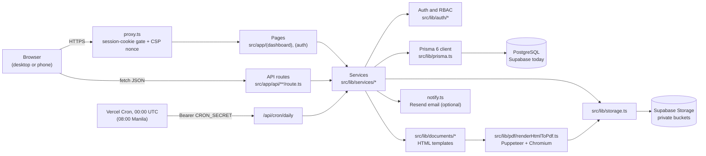
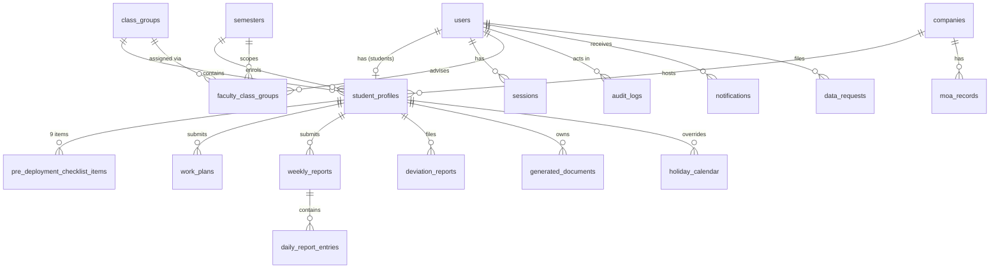

# 08. Technical design

> Draft for adviser review — flows and rules may change; see [README](README.md).

_Last updated: 23 October 2026. Audience: IT office, maintainers, developers. Status labels: **Built**, **In progress**, **Planned**._

This is the technical design document (TDD) for IDSMS-CIS as built on `develop` (Phases 1–3, Phase 4 Workstreams A, B, E, C, F, G and the D7 status-only checklist, PR #85). File paths are relative to the repository root.

## 1. Architecture

IDSMS is a **modular monolith**: one Next.js 14 (App Router) application containing the pages, the API routes and the business logic, backed by one PostgreSQL database and one object store.



Layering rules (NFR-MNT-06): pages and route handlers stay thin; business rules live in `src/lib/services/`; input validation uses zod schemas in `src/lib/validators/`; errors map to HTTP responses in `src/lib/utils/apiError.ts`.

## 2. Tech stack

Versions from `package.json` (caret ranges as declared).

| Layer           | Technology                                                                                  | Version                   |
| --------------- | ------------------------------------------------------------------------------------------- | ------------------------- |
| Runtime         | Node.js                                                                                     | ≥ 24 (`engines`)          |
| Framework       | Next.js (App Router)                                                                        | 14.2.35                   |
| UI              | React, Tailwind CSS, shadcn/ui (Radix), lucide-react, sonner                                | React 18, Tailwind ^3.4.1 |
| Language        | TypeScript                                                                                  | ^5                        |
| Validation      | zod                                                                                         | ^4.4.3                    |
| Forms           | react-hook-form                                                                             | ^7.86.0                   |
| ORM             | Prisma (`prisma`, `@prisma/client`)                                                         | ^6.19.3                   |
| Database        | PostgreSQL via Supabase (pgvector extension enabled)                                        | —                         |
| Auth            | NextAuth.js with `@next-auth/prisma-adapter`, bcryptjs                                      | ^4.24.15, ^3.0.3          |
| Object storage  | `@supabase/supabase-js` (server-side only)                                                  | ^2.112.4                  |
| PDF             | `puppeteer-core` + `@sparticuz/chromium`                                                    | ^25.8.0, ^149.0.0         |
| Email           | Resend, `@react-email/components`                                                           | ^6.22.0                   |
| Spreadsheets    | SheetJS `xlsx`                                                                              | 0.20.3 (CDN tarball)      |
| Tests           | Jest, jest-environment-jsdom, Testing Library, jest-mock-extended; Cypress (e2e, not in CI) | ^30.4.2; Cypress ^15.21.0 |
| Code quality    | ESLint (next config), Prettier, Husky + lint-staged                                         | Prettier ^3.9.6           |
| Hosting (today) | Vercel (app, cron) + Supabase (DB, storage)                                                 | —                         |
| AI (Planned)    | Gemini `text-embedding-004`, Gemini 2.5 Flash, pgvector                                     | Not built                 |

## 3. Folder structure

```text
.config/prisma.ts              Prisma CLI config (database URL for the CLI, schema location)
deploy/                        self-hosting stack: Dockerfile, docker-compose.yml, Caddyfile, OPERATIONS.md
prisma/
  schema.prisma                data model (single source for tables Prisma manages)
  migrations_manual/           001–018 hand-run SQL, applied in number order
  seed-holidays.ts             Philippine holidays seed
src/
  proxy.ts                     route protection and the CSP nonce (Next 16's middleware)
  app/
    (auth)/login               sign-in page
    (legal)/privacy, terms     public privacy notice and terms of use
    auth/reset-password        password reset request and token pages
    change-password            forced / voluntary password change
    (dashboard)/               every signed-in page, one folder per route
      _components/             the shell shared by those pages: menu, account menu, bell,
                               consent dialog, role dashboards (private: not a route)
    api/                       JSON route handlers (inventory in section 5)
  components/                  shared UI used across route groups (page header, footer, charts…)
    ui/                        shadcn/ui primitives
    emails/                    React Email templates
  lib/
    services/<domain>/         business logic, grouped by internship domain (section 4)
    ai/                        AI evaluation, scrubbing and prompts behind aiService
    auth/                      authOptions.ts, session.ts (requireUserPage/Api, requireRole), confirmPassword.ts
    documents/                 HTML templates and data loaders for each PDF
    pdf/                       renderHtmlToPdf.ts (Puppeteer)
    validators/                zod schemas
    utils/                     small pure helpers (deadlines, Excel, names, labels, safe paths)
    storage.ts                 the only module that talks to object storage (STORAGE_DRIVER: supabase | s3)
  testUtils/                   shared Jest helpers (Prisma mock)
  types/                       shared TypeScript types
docs/                          all documentation, catalogued in docs/README.md
scripts/                       one-off scripts (AI golden-set evaluation)
.github/workflows/ci.yml       CI pipeline
vercel.json                    daily cron definition
```

Each service's test sits next to it (`fooService.test.ts`). Route-specific components live inside their route folder; a component used by several route groups goes in `src/components/`.

## 4. Service map

| Service (`src/lib/services/<domain>/`)    | Responsibility                                                                                                                                                               |
| ----------------------------------------- | ---------------------------------------------------------------------------------------------------------------------------------------------------------------------------- |
| `accounts/userService.ts`                 | Credentials check, lockout, session revocation, password reset/change, bulk import, `assertCanAccessStudent` (record-level RBAC), user listing.                              |
| `accounts/auditService.ts`                | `logEvent`: append a row to `audit_logs` (optionally inside the caller's transaction).                                                                                       |
| `accounts/auditLogQuery.ts`               | Filtered audit log queries for the audit log page and export.                                                                                                                |
| `predeployment/checklistService.ts`       | Checklist progress, review (Approve/Return), the 9/9 endorsement gate (`isEndorsementGateSatisfied`).                                                                        |
| `predeployment/companyService.ts`         | Companies, MOA records and their lifecycle, verification, expiring-MOA query.                                                                                                |
| `predeployment/workPlanService.ts`        | Work plan submission, coordinator review, approved-plan locking, history.                                                                                                    |
| `attendance/attendanceService.ts`         | Schedules, holidays, deviation reports, schedule changes, confirmed/pending hours, projected completion, required-hours and final-report-threshold settings, attendance CSV. |
| `reports/weeklyReportService.ts`          | Weekly form generation, daily entries, submission (late flag, reference code), the four review actions, preview.                                                             |
| `reports/monthlyReportService.ts`         | Monthly eligibility (all weeks Approved/Regarded) and submission.                                                                                                            |
| `reports/documentService.ts`              | PDF generation with retry for weekly, monthly, endorsement (single and bulk) and final cover; signed download URLs.                                                          |
| `calendar/calendarService.ts`             | Unified calendar events per role, high-volume weeks, endorsement-demand clusters.                                                                                            |
| `dashboards/complianceService.ts`         | Compliance rows and statuses for dashboards, filters, weekly summary, Excel shapes.                                                                                          |
| `dashboards/attentionService.ts`          | The student's "Needs attention" counts.                                                                                                                                      |
| `academic/semesterService.ts`             | Create, activate (exactly one active) and archive semesters.                                                                                                                 |
| `notifications/notify.ts`                 | Notification backbone: in-app row always, email when Resend is configured, dedupe; never throws.                                                                             |
| `notifications/notificationEvents.ts`     | One function per event trigger (account created, report submitted/returned, checklist, work plan, deviation, endorsement).                                                   |
| `notifications/notificationRecipients.ts` | Recipient lookups (student, assigned faculty, department staff, Super Admins).                                                                                               |
| `notifications/notificationService.ts`    | Report-status email (FR-WR-07).                                                                                                                                              |
| `notifications/scheduledNotifications.ts` | The daily job: deadline reminders, MOA warnings, DSAR reminders, retention scan; notification settings.                                                                      |
| `notifications/inbox.ts`                  | List notifications, mark one or all read.                                                                                                                                    |
| `privacy/dataRequestService.ts`           | DSAR tickets (15-day SLA), queue, fulfilment, personal-data workbook.                                                                                                        |
| `privacy/retentionService.ts`             | Quarterly 3-year retention scan, keep/delete review.                                                                                                                         |
| `privacy/adminExportService.ts`           | The six Export Center workbooks.                                                                                                                                             |
| `ai/aiService.ts`                         | AI adapter (Gemini embeddings and sentiment, names removed first); switched off until enabled in settings (Workstream D, #90).                                               |
| `academic/classGroupService.ts`           | Class groups: create, rename, delete, assign faculty advisers per semester.                                                                                                  |
| `attendance/creditedHours.ts`             | SLU credited-hours rules: time within the shift, approved overtime of 30+ minutes, no offsetting.                                                                            |
| `attendance/timeRequestService.ts`        | Leave, overtime and undertime requests: filing, review, proof.                                                                                                               |
| `reports/finalReportService.ts`           | Final Technical Report: unlock threshold, submission, coordinator review, HTE evaluation.                                                                                    |
| `conduct/conductService.ts`               | Conduct records (warnings, demerits, violations, suspensions), optional hours, revoke.                                                                                       |
| `conduct/disputeService.ts`               | Intern disputes of a deduction; staff decline with a note (excuse/revoke accept via `acceptOpenDisputes`). |
| `conduct/deductionService.ts`             | SLU deduction matrix, automatic late/unsupported counts, excused exceptions, tally.                                                                                          |

## 5. API route inventory

All routes are under `src/app/api/`. "Signed in" means any active user; "own or assigned" means `assertCanAccessStudent`: the student themself, a faculty adviser assigned to the student's class group for that semester, or a coordinator / Super Admin. Roles: SA = Super Admin, DC = Department coordinator, FA = Faculty adviser, SI = Student intern.

### Authentication and users

| Method    | Path                               | Roles          | Purpose                                                    |
| --------- | ---------------------------------- | -------------- | ---------------------------------------------------------- |
| GET, POST | `/api/auth/[...nextauth]`          | Public         | NextAuth sign-in/sign-out (credentials, database sessions) |
| POST      | `/api/auth/change-password`        | Signed in      | Change own password (forced on first login)                |
| POST      | `/api/auth/reset-password/request` | Public         | Send a 1-hour reset link                                   |
| POST      | `/api/auth/reset-password/confirm` | Public (token) | Set a new password; revokes sessions                       |
| GET       | `/api/users`                       | SA, DC         | List users                                                 |
| POST      | `/api/users`                       | SA             | Create a user                                              |
| GET       | `/api/users/[id]`                  | SA, DC         | User profile                                               |
| PATCH     | `/api/users/[id]`                  | SA, DC         | Activate / deactivate (revokes sessions)                   |
| POST      | `/api/users/[id]/force-logout`     | SA             | End all sessions of a user                                 |
| POST      | `/api/users/[id]/unlock`           | SA             | Clear a lockout                                            |
| POST      | `/api/users/bulk-import`           | SA, DC         | CSV/Excel class-list import                                |
| PATCH     | `/api/profile/full-name`           | SI             | Set own legal name                                         |

### Companies, MOAs, checklist, work plans

| Method     | Path                                          | Roles                               | Purpose                                     |
| ---------- | --------------------------------------------- | ----------------------------------- | ------------------------------------------- |
| GET        | `/api/companies`                              | Signed in                           | List/search companies                       |
| POST       | `/api/companies`                              | Signed in                           | Register a company                          |
| GET        | `/api/companies/[id]`                         | Signed in                           | Company details                             |
| PATCH      | `/api/companies/[id]`                         | FA, DC, SA                          | Edit company; set verified                  |
| GET, POST  | `/api/companies/[id]/moa`                     | FA, DC, SA                          | List / add MOA records (Drive link or PDF)  |
| GET, PATCH | `/api/moa/[id]`                               | FA, DC, SA                          | Read / change MOA status                    |
| GET        | `/api/students/[studentProfileId]/checklist`  | Own or assigned                     | Checklist progress                          |
| PATCH      | `/api/checklist-items/[id]/review`            | FA, DC, SA (assigned)               | Approve or Return (note required on Return) |
| GET, POST  | `/api/students/[studentProfileId]/work-plans` | Own or assigned (POST: the student) | Work plan history / submit                  |
| GET        | `/api/work-plans/[id]`                        | Own or assigned                     | One work plan                               |
| PATCH      | `/api/work-plans/[id]/review`                 | DC, SA                              | Approve or Return a work plan               |

The checklist upload and file-download routes were removed by D7 (PR #85).

### Attendance, schedules, deviations

| Method      | Path                                                      | Roles           | Purpose                                        |
| ----------- | --------------------------------------------------------- | --------------- | ---------------------------------------------- |
| POST, PATCH | `/api/students/[studentProfileId]/schedule`               | SI              | Configure schedule / request a schedule change |
| PATCH       | `/api/work-plans/[id]/schedule-change/faculty-review`     | FA              | First-step validation of a schedule change     |
| PATCH       | `/api/work-plans/[id]/schedule-change/coordinator-review` | DC, SA          | Final approval of a schedule change            |
| GET         | `/api/students/[studentProfileId]/holidays`               | Own or assigned | Holiday calendar                               |
| PATCH       | `/api/students/[studentProfileId]/holidays`               | SI              | Mark holidays applicable                       |
| GET         | `/api/students/[studentProfileId]/deviations`             | Own or assigned | Deviation reports                              |
| POST        | `/api/students/[studentProfileId]/deviations`             | SI              | Submit a deviation report (optional proof)     |
| PATCH       | `/api/deviations/[id]/validate`                           | FA, DC, SA      | Validate or reject                             |
| GET         | `/api/deviations/[id]/proof`                              | Own or assigned | Signed URL for a proof file                    |
| GET         | `/api/students/[studentProfileId]/attendance-summary`     | Own or assigned | Confirmed/pending hours, projection            |
| GET         | `/api/students/[studentProfileId]/attendance-export`      | Own or assigned | Attendance CSV                                 |
| GET         | `/api/calendar`                                           | Signed in       | Role-specific calendar events                  |

### Reports and documents

| Method    | Path                                                   | Roles                             | Purpose                                   |
| --------- | ------------------------------------------------------ | --------------------------------- | ----------------------------------------- |
| GET       | `/api/students/[studentProfileId]/weekly-reports`      | Own or assigned                   | List weekly reports                       |
| POST      | `/api/students/[studentProfileId]/weekly-reports`      | SI                                | Create the form for a week                |
| GET       | `/api/weekly-reports/[id]`                             | Own or assigned                   | One report                                |
| PATCH     | `/api/weekly-reports/[id]`                             | SI                                | Save a daily entry                        |
| POST      | `/api/weekly-reports/[id]/submit`                      | SI                                | Submit (late reason if past the deadline) |
| GET       | `/api/weekly-reports/[id]/preview`                     | SI                                | Preview                                   |
| PATCH     | `/api/weekly-reports/[id]/review`                      | FA (assigned)                     | Approve / Return / Regard / Disregard     |
| GET, POST | `/api/weekly-reports/[id]/pdf`                         | Own or assigned                   | Download / regenerate PDF                 |
| GET, POST | `/api/students/[studentProfileId]/monthly-reports`     | Own or assigned (POST: SI)        | List / submit monthly reports             |
| GET, POST | `/api/monthly-reports/[id]/pdf`                        | Own or assigned                   | Download / regenerate PDF                 |
| GET       | `/api/students/[studentProfileId]/endorsement-letter`  | Own or assigned                   | Download endorsement letter               |
| POST      | `/api/students/[studentProfileId]/endorsement-letter`  | FA, DC, SA (assigned)             | Generate (9/9 gate)                       |
| POST      | `/api/class-groups/[classGroupId]/endorsement-letters` | FA (own groups), DC, SA; password | Bulk letters (max 40)                     |
| GET       | `/api/students/[studentProfileId]/final-cover`         | Own or assigned                   | Download final report cover               |
| POST      | `/api/students/[studentProfileId]/final-cover`         | SI                                | Generate (hours threshold)                |

### Dashboards, settings, notifications, semesters

| Method | Path                                   | Roles                     | Purpose                    |
| ------ | -------------------------------------- | ------------------------- | -------------------------- |
| GET    | `/api/compliance/export`               | SA, DC, FA (own students) | Compliance table to Excel  |
| GET    | `/api/compliance/weekly-summary`       | SA, DC, FA                | Weekly summary to Excel    |
| GET    | `/api/config/required-hours`           | Signed in                 | Required hours per program |
| PATCH  | `/api/config/required-hours`           | SA                        | Change required hours      |
| GET    | `/api/config/notifications`            | SA, DC, FA                | Reminder settings          |
| PATCH  | `/api/config/notifications`            | SA                        | Change reminder settings   |
| GET    | `/api/notifications`                   | Signed in                 | Own inbox                  |
| PATCH  | `/api/notifications`                   | Signed in                 | Mark all read              |
| PATCH  | `/api/notifications/[id]/read`         | Signed in (own)           | Mark one read              |
| GET    | `/api/semesters`                       | SA, DC                    | List semesters             |
| POST   | `/api/semesters`                       | SA                        | Create semester            |
| POST   | `/api/semesters/[semesterId]/activate` | SA                        | Activate (only one active) |
| POST   | `/api/semesters/[semesterId]/archive`  | SA                        | Archive (deletes nothing)  |

### Compliance and privacy (Workstream G)

| Method | Path                                   | Roles                                           | Purpose                                                                                                  |
| ------ | -------------------------------------- | ----------------------------------------------- | -------------------------------------------------------------------------------------------------------- |
| GET    | `/api/audit-logs/export`               | SA                                              | Audit log to Excel (max 10,000 rows)                                                                     |
| POST   | `/api/admin/exports/[kind]`            | SA; password                                    | Export Center workbook (`users`, `students`, `attendance`, `reports`, `checklist`, `companies`); audited |
| POST   | `/api/data-requests`                   | Signed in                                       | Create own DSAR (one open per user)                                                                      |
| POST   | `/api/admin/data-requests/[id]/export` | SA; password                                    | Personal-data workbook for a request                                                                     |
| POST   | `/api/admin/data-requests/[id]/fulfil` | SA                                              | Mark request fulfilled                                                                                   |
| POST   | `/api/admin/retention/[id]/keep`       | SA                                              | Keep a flagged file                                                                                      |
| POST   | `/api/admin/retention/[id]/delete`     | SA; password                                    | Delete a flagged file                                                                                    |
| GET    | `/api/cron/daily`                      | Scheduler (`Authorization: Bearer CRON_SECRET`) | Daily job                                                                                                |

## 6. Data model

Full detail (every column, enum, JSON field, storage path and planned change) is in [14. Data schema](14-data-schema.md). Request flows and state diagrams are in [13. App flow](13-app-flow.md); UI tokens and components in [15. Design brief](15-design-brief.md).

### 6.1 Main tables



### 6.2 All models (`prisma/schema.prisma`)

| Model (table)                                                   | Purpose                                                                                                                                                                      |
| --------------------------------------------------------------- | ---------------------------------------------------------------------------------------------------------------------------------------------------------------------------- |
| `Account` (`accounts`)                                          | NextAuth adapter table (unused by credentials sign-in, required by the adapter).                                                                                             |
| `Session` (`sessions`)                                          | Database sessions; deleting rows revokes access instantly (FR-UM-11).                                                                                                        |
| `User` (`users`)                                                | Login identity: email, password hash, role, active flag, forced reset, failed attempts, lock time; soft delete.                                                              |
| `PasswordResetToken` (`password_reset_tokens`)                  | Hashed 1-hour reset tokens.                                                                                                                                                  |
| `StudentProfile` (`student_profiles`)                           | Student number, program, class group, semester, company, required and rendered hours, start date, position, legal name.                                                      |
| `ClassGroup` (`class_groups`)                                   | A class (program, type, dates).                                                                                                                                              |
| `FacultyClassGroup` (`faculty_class_groups`)                    | Which faculty adviser handles which class group in which semester.                                                                                                           |
| `Semester` (`semesters`)                                        | Semester dates, academic year, active flag, archive time.                                                                                                                    |
| `Company` (`companies`)                                         | Host company (HTE), modality, supervisor, verified flag.                                                                                                                     |
| `MoaRecord` (`moa_records`)                                     | MOA status, validity, programs covered, Drive link or stored PDF path.                                                                                                       |
| `PreDeploymentChecklistItem` (`pre_deployment_checklist_items`) | One row per student per requirement: status, reviewer, date, comments (legacy `file_path` no longer written since D7).                                                       |
| `WorkPlan` (`work_plans`)                                       | Planned tasks, schedule config, schedule change history, approval metadata, coordinator.                                                                                     |
| `WeeklyReport` (`weekly_reports`)                               | Week dates, totals, status, faculty action, revision history (submissions, late reasons, reference codes); reserved AI columns.                                              |
| `DailyReportEntry` (`daily_report_entries`)                     | One day: attendance status, scheduled/actual hours, accomplishments, tools, time in/out.                                                                                     |
| `DeviationReport` (`deviation_reports`)                         | Absence/overtime/undertime with reason, optional proof path, validation status. L1 proposes reworking it into status-only Leave & Time Requests (pending confirmation, Q19). |
| `GeneratedDocument` (`generated_documents`)                     | PDF metadata: type, storage path, reference code, period, status (pending draft, generated, failed).                                                                         |
| `Notification` (`notifications`)                                | In-app and email notification rows, payload, read time.                                                                                                                      |
| `AuditLog` (`audit_logs`)                                       | Append-only security and data event log.                                                                                                                                     |
| `DataRequest` (`data_requests`)                                 | DSAR tickets with due date and fulfilment.                                                                                                                                   |
| `RetentionFlag` (`retention_flags`)                             | Files flagged by the retention scan and their review outcome.                                                                                                                |
| `HolidayCalendarEntry` (`holiday_calendar`)                     | PH national/regional holidays and per-student overrides.                                                                                                                     |
| `SystemConfig` (`system_config`)                                | Key/value settings: required hours, notification settings, final-report thresholds, retention scan time.                                                                     |

**Planned schema changes:** migration 008 (L1) adds request columns to deviation reports, a second time range per day and a semester "Week 1 starts" date; L2 adds conduct records and deduction exceptions.

## 7. Authentication and RBAC

- **NextAuth v4, database sessions** (`src/lib/auth/authOptions.ts`). The credentials provider normally only supports JWTs; IDSMS creates a real `sessions` row at sign-in (via the `jwt.encode` override) and the cookie holds that session token. Sessions last 30 minutes, refreshed every 5 minutes of activity. Cookies are HttpOnly, and Secure under HTTPS.
- **Proxy** (`src/proxy.ts`, Next 16's name for middleware) checks that a session cookie exists, redirects to `/login` otherwise (public pages such as `/privacy` and `/terms` excepted), and sets a per-request CSP nonce. It does not query the database, so it is a UX gate, not the security boundary.
- **The real checks** run in every page and route: `requireUserPage()` / `requireUserApi()` load the session from the database and reject inactive users; `requireRole(user, roles)` checks the role; `assertCanAccessStudent` (in `userService.ts`) enforces record ownership: students only themselves, faculty only students in their assigned class group and semester.
- **Forced password change:** the dashboard layout redirects users with `mustResetPassword` to `/change-password`.
- **Lockout** (`verifyCredentials`): 5 consecutive failures lock the account for 15 minutes and delete its sessions. Hardened in PR #84: the slow bcrypt check runs outside the database transaction; the failure counter uses an atomic increment; a successful login uses a conditional update so it cannot clear a lock or accept a password changed concurrently; an expired lock re-locks correctly. Every attempt is audited.
- **Re-authentication** (`src/lib/auth/confirmPassword.ts`): sensitive routes require the password in the request body and run it through the same `verifyCredentials`, so failures count toward lockout (returns 423 when locked).
- **Instant revocation:** `revokeSessionsForUser` is called on lockout, deactivation, forced logout and password reset.

## 8. PDF generation pipeline

1. A service loads the data (`src/lib/documents/*Data.ts`) and renders HTML from a template (`*Template.ts`, shared letterhead in `letterhead.ts`). Dates are formatted in Asia/Manila.
2. `renderHtmlToPdf` (`src/lib/pdf/`) launches headless Chromium: `@sparticuz/chromium` on Vercel/Linux, or the browser at `PUPPETEER_EXECUTABLE_PATH` (local Windows, Phase 5 Docker image). Each step has a 15-second timeout.
3. `documentService.renderAndStoreDocument` wraps generation in `withRetry` (1 attempt plus up to 3 retries, 1 s / 2 s / 4 s, no new attempt after 60 s), uploads the PDF to the `generated-documents` bucket (overwriting on regenerate) and updates the `generated_documents` row to `GENERATED` or `FAILED`.
4. Downloads go through our own routes, which redirect to a 5-minute signed URL.

Reference codes: `WR-YYYYMMDD-XXXXXXXX` (week start), `MR-YYYYMM-XXXXXXXX`, `EL-YYYYMMDD-XXXXXXXX`, `FC-YYYYMMDD-XXXXXXXX` (Manila date). PDF routes allow 120 s; bulk endorsement 300 s.

## 9. Scheduled jobs

One daily job (Vercel Hobby allows one cron a day): `vercel.json` calls `GET /api/cron/daily` at **00:00 UTC (08:00 Manila)** with `Authorization: Bearer CRON_SECRET` (constant-time comparison). `runDailyNotifications` in `scheduledNotifications.ts`:

1. **Deadline reminders** for open or not-started weekly reports, for each configured window (default 48 h and 24 h), deduplicated per student-week-window (DB partial unique index from migration 006).
2. **MOA expiry warnings** to coordinators and Super Admins (default 30 days).
3. **DSAR reminders** to Super Admins for requests due within 3 days or overdue.
4. **Retention scan**, self-gated to run every 90 days.

The route then runs the AI batch (a no-op while AI is off) and `documentService.pruneOldReportPdfs`: weekly and monthly PDFs generated more than 14 days ago are deleted and their rows set back to `PENDING_DRAFT`, so the page shows "Generate PDF" and re-renders them with the same reference code. Endorsement letters, covers and final reports are kept. This keeps the `generated-documents` bucket within the free plan's 1 GB.

Errors are isolated per step and per student; any error makes the route return 500 so the scheduler shows a failed run. On the lab server (Phase 5) a host cron or cron container calls the same URL.

## 10. Storage

- All object storage goes through `src/lib/storage.ts` (portability rule 1). Buckets are private: `checklist-documents` (legacy checklist files and deviation proofs), `moa-documents` (MOA PDFs), `generated-documents` (PDFs).
- Uploads are checked server-side: PDF up to 5 MB, JPG/PNG up to 2 MB.
- Files are never served by public URL; the app creates 5-minute signed URLs after its own access check.
- The service-role key is server-only; there is no `NEXT_PUBLIC_` storage key.

## 11. Exports

Excel files are built with SheetJS (`src/lib/utils/excelExport.ts`). `toSheetRows` prefixes values that a spreadsheet would treat as formulas (`= + - @`, tab, CR) with `'`. Dates are in Manila time. Export builders use explicit column selection and never include password hashes, tokens or storage paths. Export Center and DSAR exports require re-authentication and write an audit entry.

## 12. Database migrations

Prisma manages tables with `prisma db push` (there is no Prisma migrations history). Anything Prisma cannot express lives in `prisma/migrations_manual/`, run by hand in the Supabase SQL editor **after** `db push`, in order:

| File                                     | What it does                                                                                                                                                                                                                                      |
| ---------------------------------------- | ------------------------------------------------------------------------------------------------------------------------------------------------------------------------------------------------------------------------------------------------- |
| `001_vector_extension_and_audit_rls.sql` | Enables the `vector` extension (for the planned AI feature) and adds RLS policies blocking UPDATE/DELETE on `audit_logs` (defense in depth; see 007).                                                                                             |
| `002_default_deny_rls.sql`               | Enables RLS with no policies on every other table, so the Supabase public/anon key could read nothing if leaked.                                                                                                                                  |
| `003_storage_buckets.sql`                | Creates the private `checklist-documents` and `moa-documents` buckets with size and MIME limits.                                                                                                                                                  |
| `004_generated_documents_bucket.sql`     | Creates the private `generated-documents` bucket for PDFs.                                                                                                                                                                                        |
| `005_phase4_columns.sql`                 | Adds nullable `time_in`/`time_out` (with HH:MM check constraints), `notifications.read_at`, `student_profiles.full_name`, `companies.supervisor_position`. Idempotent.                                                                            |
| `006_notification_indexes.sql`           | Partial unique index deduplicating in-app notifications by `dedupeKey`, plus the inbox index.                                                                                                                                                     |
| `007_compliance.sql`                     | Append-only **triggers** on `audit_logs` (block UPDATE, DELETE, TRUNCATE for every role), RLS on `data_requests` and `retention_flags`, and a partial unique index allowing one open data request per user. Includes manual verification queries. |
| `008_leave_time.sql`                     | Workstream L1: leave and time requests, two time ranges per day, Week 1 date, credited-hours columns.                                                                                                                                             |
| `009_conduct_deductions.sql`             | Workstream L2: conduct records and deduction-matrix exceptions (two tables, RLS default-deny).                                                                                                                                                    |
| `010_final_technical_report.sql`         | Workstream H: final technical report table and its status enum.                                                                                                                                                                                   |
| `011_ai_sentiment_reasoning.sql`         | Workstream D: the AI sentiment "brief reasoning" column (FR-AI-03).                                                                                                                                                                               |
| `012_fk_indexes.sql`                     | Indexes on foreign keys used by per-intern lookups, review counts, force-logout and the audit-log filter.                                                                                                                                         |
| `013_privacy_consent.sql`                | When each user agreed to the privacy notice, and which version.                                                                                                                                                                                   |
| `014_checklist_moa_settings.sql`         | Checklist and MOA settings: new checklist items, start-before-MOA override, MOA Drive link, foreign HTE flag. Run in **two** passes (see the file).                                                                                               |
| `015_user_full_name.sql`                 | `users.full_name`: a display name for staff accounts.                                                                                                                                                                                             |
| `016_role_timeouts.sql`                  | `statement_timeout` 15 s and `idle_in_transaction_session_timeout` 30 s for the app's role (`CURRENT_USER`, so the same file works on the lab stack).                                                                                             |
| `017_company_holidays.sql`               | A host company's own non-working days (FR-AT-02): `holiday_calendar.company_id` and `created_by`, and `HolidayType` value `COMPANY`. Additive.                                                                                                    |
| `018_deduction_disputes.sql`             | `deduction_disputes`: an intern's dispute of a deduction and its outcome (ACCEPTED by excuse/revoke, or DECLINED with a note); one open dispute per item (partial unique index). Additive.                                                        |

**The rule:** run `prisma db push`, then re-run every manual SQL file in order, because `db push` can drop indexes it does not know about. Migration 007 means users can never be hard-deleted (the audit log's foreign key would need an UPDATE); the app only deactivates users. New manual migrations are applied to a database only with the PM's approval.

## 13. Testing strategy

- **Unit and integration tests:** Jest with Testing Library and a mocked Prisma client (`jest-mock-extended`). About 70 test files sit next to the code (`*.test.ts(x)`); the suite runs roughly 700 tests including parameterised cases. Critical logic (hours, gating, RBAC, lockout, deadlines in Manila time, retry) has focused tests.
- **CI** (`.github/workflows/ci.yml`, on pushes and pull requests to `main` and `develop`, Node 24): `npm ci`, `prisma generate`, lint, type check, `prisma validate`, `jest --coverage`, `next build`. Placeholder environment values only; no secrets in CI.
- **Pre-commit:** Husky + lint-staged (Prettier, ESLint).
- **Code review:** each workstream is reviewed before merging.
- **End-to-end (Cypress)** is configured but not in CI. Performance testing (p95 TTFB ≤ 800 ms), coverage targets (≥ 70% services, ≥ 90% critical logic) and UAT are **Planned** for Phase 5.

## 14. Environment variables

Names only (from `.env.example`). Real values live in `.env.local` (development) or the hosting provider's settings, never in the repository.

| Variable                          | Purpose                                            |
| --------------------------------- | -------------------------------------------------- |
| `DATABASE_URL`                    | Pooled Postgres connection for the app             |
| `DIRECT_URL`                      | Direct Postgres connection for schema pushes       |
| `NEXTAUTH_SECRET`                 | NextAuth signing secret                            |
| `NEXTAUTH_URL`                    | Public base URL (also decides Secure cookies)      |
| `STUDENT_DEFAULT_PASSWORD_PEPPER` | Secret key for deriving default student passwords  |
| `SUPABASE_URL`                    | Storage endpoint                                   |
| `SUPABASE_SERVICE_ROLE_KEY`       | Server-only storage key                            |
| `GEMINI_API_KEY`                  | Planned AI feature                                 |
| `RESEND_API_KEY`                  | Email sending (optional)                           |
| `RESEND_FROM_EMAIL`               | Sender address on a verified domain (optional)     |
| `PUPPETEER_EXECUTABLE_PATH`       | Local Chrome/Chromium for PDFs (not set on Vercel) |
| `CRON_SECRET`                     | Shared secret for `/api/cron/daily`                |

## 15. Deployment

| Aspect     | Today (development and demo)                                    | Phase 5 (**Planned**)                                                                |
| ---------- | --------------------------------------------------------------- | ------------------------------------------------------------------------------------ |
| App        | Vercel (serverless Next.js)                                     | Docker container on a dedicated SAMCIS lab computer                                  |
| Database   | Supabase managed Postgres (one shared project for dev and demo) | Postgres + pgvector container                                                        |
| Files      | Supabase Storage                                                | MinIO (S3-compatible) behind `src/lib/storage.ts`                                    |
| PDFs       | `@sparticuz/chromium`                                           | Chromium installed in the image (`PUPPETEER_EXECUTABLE_PATH`)                        |
| Scheduling | Vercel Cron                                                     | Host cron or cron container calling `/api/cron/daily`                                |
| Access     | Vercel HTTPS URL                                                | Outbound tunnel or IT-provided address with HTTPS (interns are off campus)           |
| Deploys    | Vercel Git integration                                          | Pull-based script or self-hosted runner                                              |
| Backups    | Supabase defaults                                               | Nightly `pg_dump` + file mirror, off-site copy, tested restore; UPS and auto-restart |

The portability rules in the Phase 4 roadmap (storage only via `storage.ts`, downloads via own routes, cron as an HTTP route, Chromium via env var, plain Prisma/SQL, every env var in `.env.example`, optional internet at runtime) keep the move a configuration change. Who manages the lab machine is open question Q17. Known risk today: the shared Supabase free-tier project can pause before a demo (pre-demo check recommended).
