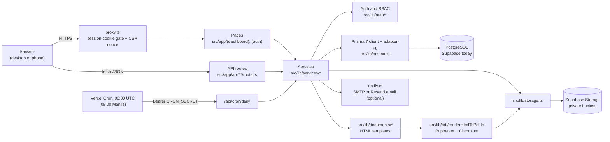
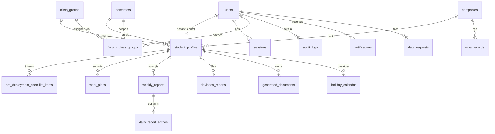

# 08. Technical design

> Draft for adviser review — flows and rules may change; see [README](README.md).

_Last updated: 12 November 2026. Audience: IT office, maintainers, developers. Status labels: **Built**, **In progress**, **Planned**._

This is the technical design document (TDD) for IDSMS-CIS as built on `develop` (version 0.5.0 and later). File paths are relative to the repository root.

## 1. Architecture

IDSMS is a **modular monolith**: one Next.js 16 (App Router) application containing the pages, the API routes and the business logic, backed by one PostgreSQL database and one object store.



Layering rules (NFR-MNT-06): pages and route handlers stay thin; business rules live in `src/lib/services/`; input validation uses zod schemas in `src/lib/validators/`; errors map to HTTP responses in `src/lib/utils/apiError.ts`.

## 2. Tech stack

Versions from `package.json` (caret ranges as declared).

| Layer           | Technology                                                                                                                  | Version                        |
| --------------- | --------------------------------------------------------------------------------------------------------------------------- | ------------------------------ |
| Runtime         | Node.js                                                                                                                     | ≥ 24 (`engines`)               |
| Framework       | Next.js (App Router)                                                                                                        | 16.4.5                         |
| UI              | React, Tailwind CSS, shadcn/ui (Radix), lucide-react, sonner                                                                | React ^19.3.1, Tailwind ^4.3.3 |
| Language        | TypeScript                                                                                                                  | ^5                             |
| Validation      | zod                                                                                                                         | ^4.6.7                         |
| Forms           | react-hook-form                                                                                                             | ^7.86.0                        |
| ORM             | Prisma (`prisma`, `@prisma/client`, `@prisma/adapter-pg`)                                                                   | ^7.10.1                        |
| Database        | PostgreSQL via Supabase (pgvector extension enabled)                                                                        | —                              |
| Auth            | NextAuth.js with `@next-auth/prisma-adapter`, bcryptjs                                                                      | ^4.24.15, ^3.0.3               |
| Object storage  | `@supabase/supabase-js` (server-side only); `@aws-sdk/client-s3` for MinIO (`STORAGE_DRIVER=s3`)                            | ^2.112.4, ^3.1156.0            |
| PDF             | `puppeteer-core` + `@sparticuz/chromium`                                                                                    | ^25.16.0, ^149.0.0             |
| Email           | `nodemailer` (SMTP) or `resend`; `@react-email/components` templates                                                        | ^10.3.1, ^6.22.0, ^1.0.12      |
| Spreadsheets    | SheetJS `xlsx`                                                                                                              | 0.20.3 (CDN tarball)           |
| Tests           | Jest, jest-environment-jsdom, Testing Library, jest-mock-extended; Cypress (e2e, not in CI)                                 | ^30.4.2; Cypress ^15.21.0      |
| Code quality    | ESLint (next config), Prettier, Husky + lint-staged                                                                         | Prettier ^3.9.6                |
| Hosting (today) | Vercel beta (app, cron; deploys from `develop`) + Supabase (DB, storage)                                                    | —                              |
| AI              | Provider port (`src/lib/ai/connections.ts`): Gemini `gemini-embedding-001` and `gemini-3.5-flash-lite` by default, pgvector | Built, advisory only           |

## 3. Folder structure

```text
.config/prisma.ts              Prisma CLI config (database URL for the CLI, schema location)
deploy/                        self-hosting stack: Dockerfile, docker-compose.yml, Caddyfile, OPERATIONS.md
prisma/
  schema.prisma                data model (single source for tables Prisma manages)
  migrations_manual/           001–031 hand-run SQL, applied in number order
  seed-holidays.ts             Philippine holidays seed
src/
  proxy.ts                     route protection and the CSP nonce (Next 16's middleware)
  app/
    (auth)/login               sign-in page
    (legal)/privacy, terms     public privacy notice and terms of use
    auth/reset-password        password reset request and token pages
    change-password            forced / voluntary password change
    (dashboard)/               every signed-in page, one folder per route
      _components/             the shell shared by those pages: menu, account menu, bell,
                               consent dialog, role dashboards (private: not a route)
    api/                       JSON route handlers (inventory in section 5)
  components/                  shared UI used across route groups (page header, footer, charts…)
    ui/                        shadcn/ui primitives
    emails/                    React Email templates
  lib/
    services/<domain>/         business logic, grouped by internship domain (section 4)
    ai/                        AI evaluation, scrubbing and prompts behind aiService
    auth/                      authOptions.ts, session.ts (requireUserPage/Api, requireRole), confirmPassword.ts
    documents/                 HTML templates and data loaders for each PDF
    pdf/                       renderHtmlToPdf.ts (Puppeteer)
    validators/                zod schemas
    utils/                     small pure helpers (deadlines, Excel, names, labels, safe paths)
    storage.ts                 the only module that talks to object storage (STORAGE_DRIVER: supabase | s3)
  testUtils/                   shared Jest helpers (Prisma mock)
  types/                       shared TypeScript types
docs/                          all documentation, catalogued in docs/README.md
scripts/                       one-off scripts (AI golden-set evaluation, Windows launcher, Blender scene)
.github/workflows/             ci.yml (CI), deploy.yml (manual lab-server deploy), backup.yml (disabled until Phase 5)
vercel.json                    daily cron definition
```

Each service's test sits next to it (`fooService.test.ts`). Route-specific components live inside their route folder; a component used by several route groups goes in `src/components/`.

## 4. Service map

| Service (`src/lib/services/<domain>/`)      | Responsibility                                                                                                                                                                   |
| ------------------------------------------- | -------------------------------------------------------------------------------------------------------------------------------------------------------------------------------- |
| `accounts/userService.ts`                   | Credentials check, lockout, session revocation, password reset/change, bulk import, `assertCanAccessStudent` (record-level RBAC), user listing.                                  |
| `accounts/auditService.ts`                  | `logEvent`: append a row to `audit_logs` (optionally inside the caller's transaction).                                                                                           |
| `accounts/auditLogQuery.ts`                 | Filtered audit log queries for the audit log page and export.                                                                                                                    |
| `predeployment/checklistService.ts`         | Checklist progress, review (Approve/Return), the 9/9 endorsement gate (`isEndorsementGateSatisfied`).                                                                            |
| `predeployment/companyService.ts`           | Companies, MOA records and their lifecycle, verification, expiring-MOA query.                                                                                                    |
| `predeployment/workPlanService.ts`          | Work plan submission, coordinator review, approved-plan locking, history.                                                                                                        |
| `attendance/attendanceService.ts`           | Schedules, holidays, deviation report rows, schedule changes, confirmed/pending hours, projected completion, required-hours and final-report-threshold settings, attendance CSV. |
| `reports/weeklyReportService.ts`            | Weekly form generation, daily entries, submission (late flag, reference code), the four review actions, preview.                                                                 |
| `reports/monthlyReportService.ts`           | Monthly eligibility (all weeks Approved/Regarded) and submission.                                                                                                                |
| `reports/documentService.ts`                | PDF generation with retry for weekly, monthly, endorsement (single and bulk) and final cover; signed download URLs.                                                              |
| `calendar/calendarService.ts`               | Unified calendar events per role, high-volume weeks, endorsement-demand clusters.                                                                                                |
| `dashboards/complianceService.ts`           | Compliance rows and statuses for dashboards, filters, weekly summary, Excel shapes.                                                                                              |
| `dashboards/attentionService.ts`            | The student's "Needs attention" counts.                                                                                                                                          |
| `academic/semesterService.ts`               | Create, activate (exactly one active) and archive semesters.                                                                                                                     |
| `notifications/notify.ts`                   | Notification backbone: in-app row always, email when SMTP or Resend is configured and the user's email switch is on, dedupe; never throws.                                       |
| `notifications/notificationEvents.ts`       | One function per event trigger (account created, report submitted/returned, checklist, work plan, deviation, endorsement).                                                       |
| `notifications/notificationRecipients.ts`   | Recipient lookups (student, assigned faculty, department staff, Super Admins).                                                                                                   |
| `notifications/notificationService.ts`      | Report-status email (FR-WR-07).                                                                                                                                                  |
| `notifications/scheduledNotifications.ts`   | The daily job: deadline reminders, MOA warnings, DSAR reminders, review digests, email retries, retention scan, expired sign-in cleanup; notification settings.                  |
| `notifications/maintenanceNotice.ts`        | The Super Admin's maintenance banner shown on every signed-in page.                                                                                                              |
| `notifications/inbox.ts`                    | List notifications, mark one or all read.                                                                                                                                        |
| `privacy/dataRequestService.ts`             | DSAR tickets (15-day SLA), queue, fulfilment, personal-data workbook.                                                                                                            |
| `privacy/retentionService.ts`               | Retention scan every 90 days for files more than 2 years past their semester; keep/delete review.                                                                                |
| `privacy/adminExportService.ts`             | The six Export Center workbooks.                                                                                                                                                 |
| `ai/aiService.ts`                           | AI adapter (Gemini embeddings and sentiment, names removed first); switched off until enabled in settings (Workstream D, #90).                                                   |
| `academic/classGroupService.ts`             | Class groups: create, rename, delete, assign faculty advisers per semester.                                                                                                      |
| `attendance/creditedHours.ts`               | SLU credited-hours rules: time within the shift, approved overtime of 30+ minutes, no offsetting.                                                                                |
| `attendance/timeRequestService.ts`          | Leave, overtime and undertime requests filed the old way: list, edit, review (JSON only, no proof upload). New OT/UT/absences are reported on the day in the weekly report.      |
| `attendance/reportedTimeRecords.ts`         | The OT/UT/absence rows reported in the weekly report (review note "Reported in the weekly report") and the adviser's note on them.                                               |
| `predeployment/companyEvaluationService.ts` | The intern's FM-VAA-052 evaluation of the host company.                                                                                                                          |
| `predeployment/placementService.ts`         | Company placement history, joining, retraction notices and transfers.                                                                                                            |
| `predeployment/visitService.ts`             | Company visits and supervisor check-ins (on site, call or online).                                                                                                               |
| `calendar/companyDaysService.ts`            | A host company's own days off, shared by every intern placed there.                                                                                                              |
| `calendar/departmentEventService.ts`        | Department events the coordinator posts on every calendar for the semester.                                                                                                      |
| `dashboards/waitingService.ts`              | "Waiting on you": everything a reviewer must decide, each with a direct link.                                                                                                    |
| `reports/finalReportService.ts`             | Final Technical Report: unlock threshold, submission, coordinator review, HTE evaluation.                                                                                        |
| `conduct/conductService.ts`                 | Conduct records (warnings, demerits, violations, suspensions), optional hours, revoke.                                                                                           |
| `conduct/disputeService.ts`                 | Intern disputes of a deduction; staff decline with a note (excuse/revoke accept via `acceptOpenDisputes`).                                                                       |
| `conduct/deductionService.ts`               | SLU deduction matrix, automatic late/unsupported counts, excused exceptions, tally.                                                                                              |

## 5. API route inventory

All routes are under `src/app/api/`. "Signed in" means any active user; "own or assigned" means `assertCanAccessStudent`: the student themself, a faculty adviser assigned to the student's class group for that semester, or a coordinator / Super Admin. Roles: SA = Super Admin, DC = Internship coordinator, FA = Faculty adviser, SI = Student intern.

Generated from `src/app/api/**/route.ts` on 12 Nov 2026 (119 route files, 150 handlers). Roles: the role check at the route; "Signed in" means the route only checks the session and the service narrows it.

#### Per student (`/api/students/[studentProfileId]/…`)

| Method | Path                                                       | Roles           | Purpose                                                                                        |
| ------ | ---------------------------------------------------------- | --------------- | ---------------------------------------------------------------------------------------------- |
| GET    | `/api/students/[studentProfileId]/attendance-export`       | Own or assigned | Attendance CSV                                                                                 |
| GET    | `/api/students/[studentProfileId]/attendance-summary`      | Own or assigned | Confirmed/pending hours, projection                                                            |
| GET    | `/api/students/[studentProfileId]/checklist`               | Own or assigned | Checklist progress                                                                             |
| GET    | `/api/students/[studentProfileId]/company-evaluation/pdf`  | Signed in       | The intern's own filled-in FM-VAA-052 as a PDF (for Google Classroom and the technical         |
| POST   | `/api/students/[studentProfileId]/company-evaluation`      | Signed in       | Company view: the intern evaluates their host company (the service checks the role and hours). |
| GET    | `/api/students/[studentProfileId]/conduct-records`         | Own or assigned | Workstream L2: the intern and their staff read conduct records; staff issue them.              |
| POST   | `/api/students/[studentProfileId]/conduct-records`         | Signed in       | Workstream L2: the intern and their staff read conduct records; staff issue them.              |
| POST   | `/api/students/[studentProfileId]/deductions/disputes`     | Signed in       | Go-live item 5: the intern disputes a deduction (the service checks the role).                 |
| POST   | `/api/students/[studentProfileId]/deductions/excuse`       | Signed in       | Workstream L2: excuse an automatic deduction item (reason code + note).                        |
| GET    | `/api/students/[studentProfileId]/deductions`              | Own or assigned | Workstream L2: the intern's tally and automatic items (intern and their staff).                |
| GET    | `/api/students/[studentProfileId]/deviations`              | Own or assigned | Deviation reports                                                                              |
| GET    | `/api/students/[studentProfileId]/endorsement-letter`      | Own or assigned | Download endorsement letter                                                                    |
| POST   | `/api/students/[studentProfileId]/endorsement-letter`      | SA, DC, FA      | Generate (9/9 gate)                                                                            |
| GET    | `/api/students/[studentProfileId]/final-cover`             | Own or assigned | Download final report cover                                                                    |
| POST   | `/api/students/[studentProfileId]/final-cover`             | SI              | Generate (hours threshold)                                                                     |
| GET    | `/api/students/[studentProfileId]/final-report/pdf`        | Own or assigned | The intern generates it once the coordinator has approved the report.                          |
| POST   | `/api/students/[studentProfileId]/final-report/pdf`        | SI              | Workstream H: anyone with access to the student downloads the generated PDF.                   |
| GET    | `/api/students/[studentProfileId]/final-report`            | Own or assigned | Workstream H: the intern's final report (gate + content); the intern saves drafts.             |
| PUT    | `/api/students/[studentProfileId]/final-report`            | SI              | Workstream H: the intern's final report (gate + content); the intern saves drafts.             |
| POST   | `/api/students/[studentProfileId]/final-report/submit`     | SI              | Workstream H: the intern submits the final report for the coordinator's review.                |
| GET    | `/api/students/[studentProfileId]/holidays`                | Own or assigned | Holiday calendar                                                                               |
| PATCH  | `/api/students/[studentProfileId]/holidays`                | SI              | Mark holidays applicable                                                                       |
| POST   | `/api/students/[studentProfileId]/holidays`                | Signed in       | Add a company day off for this intern                                                          |
| DELETE | `/api/students/[studentProfileId]/holidays`                | Signed in       | Remove a company day off                                                                       |
| PUT    | `/api/students/[studentProfileId]/monthly-reports/journal` | SI              | Save the intern's Journal on Learning Experience for a month (draft until submitted).          |
| POST   | `/api/students/[studentProfileId]/monthly-reports`         | SI              | List / submit monthly reports                                                                  |
| GET    | `/api/students/[studentProfileId]/monthly-reports`         | Own or assigned | List / submit monthly reports                                                                  |
| POST   | `/api/students/[studentProfileId]/retraction`              | Signed in       | The intern's notification of retraction for their current host company.                        |
| POST   | `/api/students/[studentProfileId]/schedule`                | SI              | Configure schedule / request a schedule change                                                 |
| PATCH  | `/api/students/[studentProfileId]/schedule`                | SI              | Configure schedule / request a schedule change                                                 |
| POST   | `/api/students/[studentProfileId]/start-before-moa`        | Signed in       | Staff only (checked in the service, with record access for faculty advisers).                  |
| GET    | `/api/students/[studentProfileId]/time-reports/[kind]`     | Own or assigned | The overtime, under time or absence report as a PDF, rendered on request from the              |
| GET    | `/api/students/[studentProfileId]/time-requests`           | Own or assigned | Workstream L1: the intern's leave / OT / UT requests. JSON only — no                           |
| POST   | `/api/students/[studentProfileId]/time-requests`           | SI              | Workstream L1: the intern's leave / OT / UT requests. JSON only — no                           |
| GET    | `/api/students/[studentProfileId]/waiver`                  | Own or assigned | SAMCIS's parental consent, waiver and undertaking, prefilled for the intern to print.          |
| POST   | `/api/students/[studentProfileId]/weekly-reports`          | SI              | Create the form for a week                                                                     |
| GET    | `/api/students/[studentProfileId]/weekly-reports`          | Own or assigned | List weekly reports                                                                            |
| GET    | `/api/students/[studentProfileId]/work-plans/pdf`          | Own or assigned | The latest work plan as a printable PDF, for the committee and the supervisor to sign.         |
| POST   | `/api/students/[studentProfileId]/work-plans/read`         | SI              | AI assist reads the intern's uploaded work plan and suggests its rows and the company's        |
| GET    | `/api/students/[studentProfileId]/work-plans`              | Own or assigned | Work plan history / submit                                                                     |
| POST   | `/api/students/[studentProfileId]/work-plans`              | Own or assigned | Work plan history / submit                                                                     |

#### `account`

| Method | Path                               | Roles     | Purpose                                                                                 |
| ------ | ---------------------------------- | --------- | --------------------------------------------------------------------------------------- |
| PATCH  | `/api/account/email-notifications` | Signed in | The signed-in person's own email switch (their row only). Off keeps notices in the bell |

#### `admin`

| Method | Path                                   | Roles | Purpose                                                                                                  |
| ------ | -------------------------------------- | ----- | -------------------------------------------------------------------------------------------------------- |
| POST   | `/api/admin/data-requests/[id]/export` | SA    | Personal-data workbook for a request                                                                     |
| POST   | `/api/admin/data-requests/[id]/fulfil` | SA    | Mark request fulfilled                                                                                   |
| POST   | `/api/admin/exports/[kind]`            | SA    | Export Center workbook (`users`, `students`, `attendance`, `reports`, `checklist`, `companies`); audited |
| POST   | `/api/admin/retention/[id]/delete`     | SA    | Delete a flagged file                                                                                    |
| POST   | `/api/admin/retention/[id]/keep`       | SA    | Keep a flagged file                                                                                      |

#### `ai`

| Method | Path                | Roles      | Purpose                                                                                |
| ------ | ------------------- | ---------- | -------------------------------------------------------------------------------------- |
| PATCH  | `/api/ai/assist`    | Signed in  | The signed-in person's own AI assist switch (their row only).                          |
| POST   | `/api/ai/clarity`   | SI         | Job 8 with the model: a second look that only picks from the same fixed questions. The |
| POST   | `/api/ai/companies` | SA, DC     | The rules (same or near name) already group these; the AI adds only what they miss.    |
| POST   | `/api/ai/feedback`  | SA, DC, FA | R2: staff rate a hint Correct / Not right. The rating only counts toward switching the |
| POST   | `/api/ai/help`      | Signed in  | Job 9: which help question (for this person's role) answers theirs, or none. It only   |

#### `audit-logs`

| Method | Path                     | Roles | Purpose                              |
| ------ | ------------------------ | ----- | ------------------------------------ |
| GET    | `/api/audit-logs/export` | SA    | Audit log to Excel (max 10,000 rows) |

#### `auth`

| Method | Path                               | Roles     | Purpose                                                    |
| ------ | ---------------------------------- | --------- | ---------------------------------------------------------- |
| GET    | `/api/auth/[...nextauth]`          | Public    | NextAuth sign-in/sign-out (credentials, database sessions) |
| POST   | `/api/auth/[...nextauth]`          | Public    | NextAuth sign-in/sign-out (credentials, database sessions) |
| POST   | `/api/auth/change-password`        | Signed in | Change own password (forced on first login)                |
| POST   | `/api/auth/reset-password/confirm` | Public    | Set a new password; revokes sessions                       |
| POST   | `/api/auth/reset-password/request` | Public    | Send a 1-hour reset link                                   |

#### `calendar`

| Method | Path                 | Roles       | Purpose                                                      |
| ------ | -------------------- | ----------- | ------------------------------------------------------------ |
| GET    | `/api/calendar/feed` | Signed link | The viewer's calendar as .ics for a phone (HMAC-signed link) |
| GET    | `/api/calendar`      | Signed in   | Role-specific calendar events                                |

#### `checklist-items`

| Method | Path                                 | Roles                 | Purpose                                                                                |
| ------ | ------------------------------------ | --------------------- | -------------------------------------------------------------------------------------- |
| PATCH  | `/api/checklist-items/[id]/review`   | FA, DC, SA (assigned) | Approve or Return (note required on Return)                                            |
| POST   | `/api/checklist-items/[id]/uploaded` | Signed in             | The intern marks one requirement "Uploaded to Classroom" (027). Owner-only, checked in |
| POST   | `/api/checklist-items/bulk-review`   | SA, DC, FA            | One notice per intern, not one per item.                                               |

#### `class-group-advisers`

| Method | Path                             | Roles  | Purpose                              |
| ------ | -------------------------------- | ------ | ------------------------------------ |
| DELETE | `/api/class-group-advisers/[id]` | SA, DC | Remove an adviser from a class group |

#### `class-groups`

| Method | Path                                                   | Roles      | Purpose                                                                     |
| ------ | ------------------------------------------------------ | ---------- | --------------------------------------------------------------------------- |
| POST   | `/api/class-groups/[classGroupId]/advisers`            | SA, DC     | Assign an adviser to a class group                                          |
| POST   | `/api/class-groups/[classGroupId]/endorsement-letters` | SA, DC, FA | Bulk letters (max 40)                                                       |
| PATCH  | `/api/class-groups/[classGroupId]`                     | SA, DC     | Rename or edit a class group                                                |
| DELETE | `/api/class-groups/[classGroupId]`                     | SA, DC     | Delete an empty class group                                                 |
| POST   | `/api/class-groups/copy-advisers`                      | SA, DC     | Efficiency item 29: copy last semester's adviser assignments into this one. |
| POST   | `/api/class-groups`                                    | SA, DC     | Create a class group                                                        |

#### `companies`

| Method | Path                         | Roles      | Purpose                                                                                  |
| ------ | ---------------------------- | ---------- | ---------------------------------------------------------------------------------------- |
| POST   | `/api/companies/[id]/join`   | SI         | Self-only: the profile comes from the session, never the request.                        |
| GET    | `/api/companies/[id]/moa`    | SA, DC, FA | List / add MOA records (Drive link or PDF)                                               |
| POST   | `/api/companies/[id]/moa`    | SA, DC, FA | List / add MOA records (Drive link or PDF)                                               |
| PUT    | `/api/companies/[id]/reply`  | Signed in  | Company view: the coordinator records the company's reply (the service checks the role). |
| GET    | `/api/companies/[id]`        | Signed in  | Company details                                                                          |
| PATCH  | `/api/companies/[id]`        | SA, DC, FA | Edit company; set verified                                                               |
| POST   | `/api/companies/[id]/visits` | Signed in  | Record SAMCIS's company visit (adviser, coordinator, admin).                             |
| POST   | `/api/companies/merge`       | SA, DC     | Merge duplicate company records                                                          |
| GET    | `/api/companies`             | SA, DC, FA | List/search companies                                                                    |
| POST   | `/api/companies`             | Signed in  | Register a company                                                                       |
| GET    | `/api/companies/similar`     | Signed in  | FR-MOA-02: any signed-in user, same as the company list (companies aren't sensitive).    |

#### `company-days`

| Method | Path                     | Roles  | Purpose                                                                           |
| ------ | ------------------------ | ------ | --------------------------------------------------------------------------------- |
| DELETE | `/api/company-days/[id]` | SA, DC | Remove a company day off                                                          |
| POST   | `/api/company-days`      | SA, DC | Company days off: the coordinator (or Super Admin) adds one for any host company. |

#### `compliance`

| Method | Path                             | Roles      | Purpose                   |
| ------ | -------------------------------- | ---------- | ------------------------- |
| GET    | `/api/compliance/export`         | SA, DC, FA | Compliance table to Excel |
| GET    | `/api/compliance/weekly-summary` | SA, DC, FA | Weekly summary to Excel   |

#### `conduct-records`

| Method | Path                               | Roles     | Purpose                                                               |
| ------ | ---------------------------------- | --------- | --------------------------------------------------------------------- |
| POST   | `/api/conduct-records/[id]/revoke` | Signed in | Workstream L2: revoke a conduct record with a reason (never deleted). |

#### `config`

| Method | Path                         | Roles      | Purpose                                                                    |
| ------ | ---------------------------- | ---------- | -------------------------------------------------------------------------- |
| GET    | `/api/config/ai`             | Public     | NFR-AI-03 threshold preview; R3 golden-set test; guardrail 2 re-embedding. |
| POST   | `/api/config/ai`             | Public     | AI settings, connections and the transparency panel (Super Admin only).    |
| PATCH  | `/api/config/ai`             | Public     | AI settings, connections and the transparency panel (Super Admin only).    |
| PATCH  | `/api/config/checklist`      | SA         | Super Admin chooses which checklist items gate the endorsement letter.     |
| PATCH  | `/api/config/deductions`     | SA         | Validate both parts before saving either, so a bad value saves nothing.    |
| PATCH  | `/api/config/maintenance`    | SA         | NFR-REL-01: Super Admin only. An empty message clears the banner.          |
| GET    | `/api/config/notifications`  | SA, DC, FA | Reminder settings                                                          |
| PATCH  | `/api/config/notifications`  | SA         | Change reminder settings                                                   |
| GET    | `/api/config/required-hours` | Signed in  | Required hours per program                                                 |
| PATCH  | `/api/config/required-hours` | SA, DC     | Change required hours                                                      |

#### `cron`

| Method | Path              | Roles         | Purpose   |
| ------ | ----------------- | ------------- | --------- |
| GET    | `/api/cron/daily` | Cron (secret) | Daily job |

#### `data-requests`

| Method | Path                 | Roles     | Purpose                             |
| ------ | -------------------- | --------- | ----------------------------------- |
| POST   | `/api/data-requests` | Signed in | Create own DSAR (one open per user) |

#### `deduction-disputes`

| Method | Path                                   | Roles     | Purpose                                                           |
| ------ | -------------------------------------- | --------- | ----------------------------------------------------------------- |
| POST   | `/api/deduction-disputes/[id]/decline` | Signed in | Go-live item 5: staff keep the deduction and tell the intern why. |

#### `deduction-exceptions`

| Method | Path                                      | Roles     | Purpose                                            |
| ------ | ----------------------------------------- | --------- | -------------------------------------------------- |
| POST   | `/api/deduction-exceptions/[id]/withdraw` | Signed in | Workstream L2: withdraw an excuse (never deleted). |

#### `department-events`

| Method | Path                          | Roles  | Purpose                                                                        |
| ------ | ----------------------------- | ------ | ------------------------------------------------------------------------------ |
| DELETE | `/api/department-events/[id]` | SA, DC | Remove a department event                                                      |
| POST   | `/api/department-events`      | SA, DC | Department events on every calendar this semester (coordinator / Super Admin). |

#### `deviations`

| Method | Path                         | Roles           | Purpose                     |
| ------ | ---------------------------- | --------------- | --------------------------- |
| GET    | `/api/deviations/[id]/proof` | Own or assigned | Signed URL for a proof file |

#### `final-reports`

| Method | Path                             | Roles     | Purpose                                                               |
| ------ | -------------------------------- | --------- | --------------------------------------------------------------------- |
| POST   | `/api/final-reports/[id]/review` | Signed in | Workstream H (FR-FT-03): coordinator / Super Admin approve or return. |

#### `health`

| Method | Path          | Roles  | Purpose                                                                       |
| ------ | ------------- | ------ | ----------------------------------------------------------------------------- |
| GET    | `/api/health` | Public | Unauthenticated and side-effect-free: the Docker healthcheck, the deploy gate |

#### `moa`

| Method | Path            | Roles      | Purpose                  |
| ------ | --------------- | ---------- | ------------------------ |
| GET    | `/api/moa/[id]` | SA, DC, FA | Read / change MOA status |
| PATCH  | `/api/moa/[id]` | SA, DC, FA | Read / change MOA status |

#### `monthly-reports`

| Method | Path                            | Roles  | Purpose                   |
| ------ | ------------------------------- | ------ | ------------------------- |
| GET    | `/api/monthly-reports/[id]/pdf` | Public | Download / regenerate PDF |
| POST   | `/api/monthly-reports/[id]/pdf` | Public | Download / regenerate PDF |

#### `notifications`

| Method | Path                           | Roles           | Purpose       |
| ------ | ------------------------------ | --------------- | ------------- |
| PATCH  | `/api/notifications/[id]/read` | Signed in (own) | Mark one read |
| GET    | `/api/notifications`           | Signed in       | Own inbox     |
| PATCH  | `/api/notifications`           | Signed in       | Mark all read |

#### `onboarding`

| Method | Path              | Roles     | Purpose                                                                       |
| ------ | ----------------- | --------- | ----------------------------------------------------------------------------- |
| POST   | `/api/onboarding` | Signed in | Beta Google sign-in: a new student sets their student number and class group. |

#### `placements`

| Method | Path                          | Roles           | Purpose                                                                                      |
| ------ | ----------------------------- | --------------- | -------------------------------------------------------------------------------------------- |
| POST   | `/api/placements/[id]/note`   | Signed in       | SAMCIS notes an intern's retraction: the placement ends and the intern may move on.          |
| GET    | `/api/placements/[id]/notice` | Own or assigned | The intern's notification of retraction as a PDF, for the intern and the staff who see them. |

#### `profile`

| Method | Path                           | Roles     | Purpose                                                                     |
| ------ | ------------------------------ | --------- | --------------------------------------------------------------------------- |
| PATCH  | `/api/profile/full-name`       | SI        | Set own legal name                                                          |
| POST   | `/api/profile/privacy-consent` | Signed in | FR-CK-05 / NFR-DP-03: both answers are logged; declining signs the user out |
| DELETE | `/api/profile/sessions`        | Signed in | Account settings → Security: sign out every other device, keeping this one. |

#### `semesters`

| Method | Path                                   | Roles  | Purpose                                                                |
| ------ | -------------------------------------- | ------ | ---------------------------------------------------------------------- |
| POST   | `/api/semesters/[semesterId]/activate` | SA     | Activate (only one active)                                             |
| POST   | `/api/semesters/[semesterId]/archive`  | SA     | Archive (deletes nothing)                                              |
| PATCH  | `/api/semesters/[semesterId]`          | SA, DC | Workstream L1: coordinator or Super Admin sets the term's Week 1 start |
| GET    | `/api/semesters`                       | SA, DC | List semesters                                                         |
| POST   | `/api/semesters`                       | SA     | Create semester                                                        |

#### `storage`

| Method | Path                    | Roles       | Purpose                                                                             |
| ------ | ----------------------- | ----------- | ----------------------------------------------------------------------------------- |
| GET    | `/api/storage/download` | Signed link | Serve a stored file for the S3/MinIO driver; the HMAC-signed link is the permission |

#### `time-requests`

| Method | Path                             | Roles      | Purpose                                                                        |
| ------ | -------------------------------- | ---------- | ------------------------------------------------------------------------------ |
| POST   | `/api/time-requests/[id]/review` | SA, DC, FA | Workstream L1: Approve, or Return with a required note. The service checks     |
| PATCH  | `/api/time-requests/[id]`        | SI         | Workstream L1: the intern edits a Pending request or resubmits a Returned one. |

#### `users`

| Method | Path                           | Roles  | Purpose                                  |
| ------ | ------------------------------ | ------ | ---------------------------------------- |
| POST   | `/api/users/[id]/force-logout` | SA     | End all sessions of a user               |
| GET    | `/api/users/[id]`              | SA, DC | User profile                             |
| PATCH  | `/api/users/[id]`              | SA, DC | Activate / deactivate (revokes sessions) |
| POST   | `/api/users/[id]/unlock`       | SA     | Clear a lockout                          |
| POST   | `/api/users/bulk-import`       | SA, DC | CSV/Excel class-list import              |
| GET    | `/api/users`                   | SA, DC | List users                               |
| POST   | `/api/users`                   | SA     | Create a user                            |

#### `weekly-reports`

| Method | Path                                 | Roles           | Purpose                                                                                    |
| ------ | ------------------------------------ | --------------- | ------------------------------------------------------------------------------------------ |
| POST   | `/api/weekly-reports/[id]/ai`        | Own or assigned | Fire-and-forget hook called by the student form right after submit, so                     |
| POST   | `/api/weekly-reports/[id]/entries`   | SI              | Remove a day added by mistake (?entryId=…), then refresh the week's totals.                |
| DELETE | `/api/weekly-reports/[id]/entries`   | SI              | Workstream L1: add a non-scheduled day (e.g. a Saturday worked as OT) to a                 |
| PUT    | `/api/weekly-reports/[id]/first-day` | SI              | The intern's first day of OJT, set from their first weekly report: the days of that week   |
| GET    | `/api/weekly-reports/[id]/pdf`       | Public          | Download / regenerate PDF                                                                  |
| POST   | `/api/weekly-reports/[id]/pdf`       | Public          | Download / regenerate PDF                                                                  |
| GET    | `/api/weekly-reports/[id]/preview`   | SI              | Preview                                                                                    |
| PATCH  | `/api/weekly-reports/[id]/review`    | FA              | Approve / Return / Regard / Disregard                                                      |
| GET    | `/api/weekly-reports/[id]`           | Own or assigned | One report                                                                                 |
| PATCH  | `/api/weekly-reports/[id]`           | SI              | Save a daily entry                                                                         |
| POST   | `/api/weekly-reports/[id]/submit`    | SI              | Submit (late reason if past the deadline)                                                  |
| POST   | `/api/weekly-reports/[id]/withdraw`  | SI              | Q21: the intern takes their own submitted week back to draft (before review and deadline). |

#### `work-plans`

| Method | Path                                                      | Roles           | Purpose                                                        |
| ------ | --------------------------------------------------------- | --------------- | -------------------------------------------------------------- |
| GET    | `/api/work-plans/[id]/file`                               | Own or assigned | Data Privacy Act: a trail of who opened an intern's documents. |
| PATCH  | `/api/work-plans/[id]/review`                             | DC, SA          | Approve or Return a work plan                                  |
| GET    | `/api/work-plans/[id]`                                    | Own or assigned | One work plan                                                  |
| PATCH  | `/api/work-plans/[id]/schedule-change/coordinator-review` | SA, DC          | Final approval of a schedule change                            |
| PATCH  | `/api/work-plans/[id]/schedule-change/faculty-review`     | FA              | First-step validation of a schedule change                     |

## 6. Data model

Full detail (every column, enum, JSON field, storage path and planned change) is in [14. Data schema](14-data-schema.md). Request flows and state diagrams are in [13. App flow](13-app-flow.md); UI tokens and components in [15. Design brief](15-design-brief.md).

### 6.1 Main tables



### 6.2 All models (`prisma/schema.prisma`)

| Model (table)                                                   | Purpose                                                                                                                                                                                                                         |
| --------------------------------------------------------------- | ------------------------------------------------------------------------------------------------------------------------------------------------------------------------------------------------------------------------------- |
| `Account` (`accounts`)                                          | NextAuth adapter table (linked accounts when beta Google sign-in is on; unused by password sign-in).                                                                                                                            |
| `Session` (`sessions`)                                          | Database sessions; deleting rows revokes access instantly (FR-UM-11).                                                                                                                                                           |
| `User` (`users`)                                                | Login identity: email, password hash, role, active flag, forced reset, failed attempts, lock time, privacy consent, display name, AI and email switches; soft delete.                                                           |
| `PasswordResetToken` (`password_reset_tokens`)                  | Hashed 1-hour reset tokens.                                                                                                                                                                                                     |
| `StudentProfile` (`student_profiles`)                           | Student number, program, class group, semester, company, required and rendered hours, start date, position, office, legal name, start-before-MOA override.                                                                      |
| `ClassGroup` (`class_groups`)                                   | A class (program, type, dates).                                                                                                                                                                                                 |
| `FacultyClassGroup` (`faculty_class_groups`)                    | Which faculty adviser handles which class group in which semester.                                                                                                                                                              |
| `Semester` (`semesters`)                                        | Semester dates, academic year, active flag, archive time, Week 1 start.                                                                                                                                                         |
| `Company` (`companies`)                                         | Host company (HTE), modality, supervisor, verified and foreign flags, the company's reply.                                                                                                                                      |
| `CompanyPlacement` (`company_placements`)                       | One row per intern per host company, from joining to leaving; retraction notice fields.                                                                                                                                         |
| `CompanyVisit` (`company_visits`)                               | Company visits and supervisor check-ins (on site, call or online) by staff.                                                                                                                                                     |
| `CompanyEvaluation` (`company_evaluations`)                     | The intern's FM-VAA-052 evaluation of the host company (16 obligations and 6 quality items, each 1–4, comments A–C); one per intern.                                                                                            |
| `MoaRecord` (`moa_records`)                                     | MOA status, validity, programs covered, Drive link or stored PDF path.                                                                                                                                                          |
| `PreDeploymentChecklistItem` (`pre_deployment_checklist_items`) | One row per student per requirement: status, reviewer, date, comments, "Uploaded to Classroom" time (legacy `file_path` no longer written since D7).                                                                            |
| `WorkPlan` (`work_plans`)                                       | Planned tasks, uploaded work plan PDF path, schedule config, schedule change history, approval metadata, coordinator.                                                                                                           |
| `WeeklyReport` (`weekly_reports`)                               | Week dates, totals, status, faculty action, revision history (submissions, late reasons, reference codes); AI columns and `ai_hints`.                                                                                           |
| `DailyReportEntry` (`daily_report_entries`)                     | One day: attendance status, scheduled/actual/credited hours, accomplishments, tools, two time ranges (`time_in`/`time_out`, `time_in_2`/`time_out_2`).                                                                          |
| `DeviationReport` (`deviation_reports`)                         | Absence/overtime/undertime: reason, optional proof link, validation status and review note. New rows come from the weekly report ("Reported in the weekly report"); Q19 answered: status only, proof stays in Google Classroom. |
| `LearningJournal` (`learning_journals`)                         | The intern's Journal on Learning Experience, one narrative per month.                                                                                                                                                           |
| `FinalTechnicalReport` (`final_technical_reports`)              | The final technical report: sections, assessment ratings, scores, attachments checklist, review.                                                                                                                                |
| `ConductRecord` (`conduct_records`)                             | Warnings, demerits, violations and suspensions, optional hours deducted, revoke fields.                                                                                                                                         |
| `DeductionException` (`deduction_exceptions`)                   | Excused deduction items (late or missing report, unsupported undertime) with reason.                                                                                                                                            |
| `DeductionDispute` (`deduction_disputes`)                       | An intern's dispute of a deduction and its outcome (accepted or declined with a note).                                                                                                                                          |
| `GeneratedDocument` (`generated_documents`)                     | PDF metadata: type, storage path, reference code, period, status (pending draft, generated, failed).                                                                                                                            |
| `Notification` (`notifications`)                                | In-app and email notification rows, payload, read time.                                                                                                                                                                         |
| `AuditLog` (`audit_logs`)                                       | Append-only security and data event log.                                                                                                                                                                                        |
| `DataRequest` (`data_requests`)                                 | DSAR tickets with due date and fulfilment.                                                                                                                                                                                      |
| `RetentionFlag` (`retention_flags`)                             | Files flagged by the retention scan and their review outcome.                                                                                                                                                                   |
| `DepartmentEvent` (`department_events`)                         | Events the coordinator posts on every calendar for the semester (no effect on hours).                                                                                                                                           |
| `HolidayCalendarEntry` (`holiday_calendar`)                     | PH national/regional holidays, company days off and per-student overrides.                                                                                                                                                      |
| `AiFeedback` (`ai_feedback`)                                    | Advisers' Correct / Not right ratings of AI hints, one per job, target and user.                                                                                                                                                |
| `SystemConfig` (`system_config`)                                | Key/value settings: required hours, notification settings, final-report thresholds, deduction matrix, maintenance notice, AI settings, retention scan time.                                                                     |

## 7. Authentication and RBAC

- **NextAuth v4, database sessions** (`src/lib/auth/authOptions.ts`). The credentials provider normally only supports JWTs; IDSMS creates a real `sessions` row at sign-in (via the `jwt.encode` override) and the cookie holds that session token. Sessions last 30 minutes, refreshed every 5 minutes of activity. Cookies are HttpOnly, and Secure under HTTPS.
- **Proxy** (`src/proxy.ts`, Next 16's name for middleware) checks that a session cookie exists, redirects to `/login` otherwise (public pages such as `/privacy` and `/terms` excepted), and sets a per-request CSP nonce. It does not query the database, so it is a UX gate, not the security boundary.
- **The real checks** run in every page and route: `requireUserPage()` / `requireUserApi()` load the session from the database and reject inactive users; `requireRole(user, roles)` checks the role; `assertCanAccessStudent` (in `userService.ts`) enforces record ownership: students only themselves, faculty only students in their assigned class group and semester.
- **Forced password change:** the dashboard layout redirects users with `mustResetPassword` to `/change-password`.
- **Lockout** (`verifyCredentials`): 5 consecutive failures lock the account for 15 minutes and delete its sessions. Hardened in PR #84: the slow bcrypt check runs outside the database transaction; the failure counter uses an atomic increment; a successful login uses a conditional update so it cannot clear a lock or accept a password changed concurrently; an expired lock re-locks correctly. Every attempt is audited.
- **Re-authentication** (`src/lib/auth/confirmPassword.ts`): sensitive routes require the password in the request body and run it through the same `verifyCredentials`, so failures count toward lockout (returns 423 when locked).
- **Instant revocation:** `revokeSessionsForUser` is called on lockout, deactivation, forced logout and password reset.

## 8. PDF generation pipeline

1. A service loads the data (`src/lib/documents/*Data.ts`) and renders HTML from a template (`*Template.ts`, shared letterhead in `letterhead.ts`). Dates are formatted in Asia/Manila.
2. `renderHtmlToPdf` (`src/lib/pdf/`) launches headless Chromium: `@sparticuz/chromium` on Vercel/Linux, or the browser at `PUPPETEER_EXECUTABLE_PATH` (local Windows, Phase 5 Docker image). Each step has a 15-second timeout.
3. `documentService.renderAndStoreDocument` wraps generation in `withRetry` (1 attempt plus up to 3 retries, 1 s / 2 s / 4 s, no new attempt after 60 s), uploads the PDF to the `generated-documents` bucket (overwriting on regenerate) and updates the `generated_documents` row to `GENERATED` or `FAILED`.
4. Downloads go through our own routes, which redirect to a 5-minute signed URL.

Reference codes: `WR-YYYYMMDD-XXXXXXXX` (week start), `MR-YYYYMM-XXXXXXXX`, `EL-YYYYMMDD-XXXXXXXX`, `FC-YYYYMMDD-XXXXXXXX`, `FTR-YYYYMMDD-XXXXXXXX` (final technical report) (Manila date). PDF routes allow 120 s; bulk endorsement 300 s.

## 9. Scheduled jobs

One daily job (Vercel Hobby allows one cron a day): `vercel.json` calls `GET /api/cron/daily` at **00:00 UTC (08:00 Manila)** with `Authorization: Bearer CRON_SECRET` (constant-time comparison). `runDailyNotifications` in `scheduledNotifications.ts`:

1. **Deadline reminders** for open or not-started weekly reports, for each configured window (default 48 h and 24 h), deduplicated per student-week-window (DB partial unique index from migration 006).
2. **MOA expiry warnings** to coordinators and Super Admins (default 30 days).
3. **DSAR reminders** to Super Admins for requests due within 3 days or overdue.
4. **Review digest** (`sendReviewDigests`): one email per adviser with what waits on them; nothing when nothing waits.
5. **Email retries** (`retryFailedEmails`): each retryable failed email is sent once more, 50 a run.
6. **Retention scan**, self-gated to run every 90 days.
7. **Sign-in cleanup** (`purgeExpiredSignIns`): deletes expired sessions and used or expired reset links.

The route then runs the AI batch (a no-op while AI is off) and `documentService.pruneOldReportPdfs`: weekly and monthly PDFs generated more than 14 days ago are deleted and their rows set back to `PENDING_DRAFT`, so the page shows "Generate PDF" and re-renders them with the same reference code. Endorsement letters, covers and final reports are kept. This keeps the `generated-documents` bucket within the free plan's 1 GB.

Errors are isolated per step and per student; any error makes the route return 500 so the scheduler shows a failed run. On the lab server (Phase 5) a host cron or cron container calls the same URL.

## 10. Storage

- All object storage goes through `src/lib/storage.ts` (portability rule 1). Buckets are private: `checklist-documents` (uploaded work plan PDFs, legacy checklist files and legacy deviation proofs; new proof is a Google Drive/Classroom link), `moa-documents` (MOA PDFs), `generated-documents` (PDFs).
- Uploads are checked server-side: PDF up to 5 MB, JPG/PNG up to 2 MB.
- Files are never served by public URL; the app creates 5-minute signed URLs after its own access check. With `STORAGE_DRIVER=s3` (MinIO) the link points at `/api/storage/download`, which checks an HMAC signature, so MinIO is never exposed to the browser.
- The service-role key is server-only; there is no `NEXT_PUBLIC_` storage key.

## 11. Exports

Excel files are built with SheetJS (`src/lib/utils/excelExport.ts`). `toSheetRows` prefixes values that a spreadsheet would treat as formulas (`= + - @`, tab, CR) with `'`. Dates are in Manila time. Export builders use explicit column selection and never include password hashes, tokens or storage paths. Export Center and DSAR exports require re-authentication and write an audit entry.

## 12. Database migrations

Prisma manages tables with `prisma db push` (there is no Prisma migrations history). Anything Prisma cannot express lives in `prisma/migrations_manual/`, run by hand in the Supabase SQL editor **after** `db push`, in order:

| File                                     | What it does                                                                                                                                                                                                                                                                                      |
| ---------------------------------------- | ------------------------------------------------------------------------------------------------------------------------------------------------------------------------------------------------------------------------------------------------------------------------------------------------- |
| `001_vector_extension_and_audit_rls.sql` | Enables the `vector` extension (for AI assist) and adds RLS policies blocking UPDATE/DELETE on `audit_logs` (defense in depth; see 007).                                                                                                                                                          |
| `002_default_deny_rls.sql`               | Enables RLS with no policies on every other table, so the Supabase public/anon key could read nothing if leaked.                                                                                                                                                                                  |
| `003_storage_buckets.sql`                | Creates the private `checklist-documents` and `moa-documents` buckets with size and MIME limits.                                                                                                                                                                                                  |
| `004_generated_documents_bucket.sql`     | Creates the private `generated-documents` bucket for PDFs.                                                                                                                                                                                                                                        |
| `005_phase4_columns.sql`                 | Adds nullable `time_in`/`time_out` (with HH:MM check constraints), `notifications.read_at`, `student_profiles.full_name`, `companies.supervisor_position`. Idempotent.                                                                                                                            |
| `006_notification_indexes.sql`           | Partial unique index deduplicating in-app notifications by `dedupeKey`, plus the inbox index.                                                                                                                                                                                                     |
| `007_compliance.sql`                     | Append-only **triggers** on `audit_logs` (block UPDATE, DELETE, TRUNCATE for every role), RLS on `data_requests` and `retention_flags`, and a partial unique index allowing one open data request per user. Includes manual verification queries.                                                 |
| `008_leave_time.sql`                     | Workstream L1: leave and time requests, two time ranges per day, Week 1 date, credited-hours columns.                                                                                                                                                                                             |
| `009_conduct_deductions.sql`             | Workstream L2: conduct records and deduction-matrix exceptions (two tables, RLS default-deny).                                                                                                                                                                                                    |
| `010_final_technical_report.sql`         | Workstream H: final technical report table and its status enum.                                                                                                                                                                                                                                   |
| `011_ai_sentiment_reasoning.sql`         | Workstream D: the AI sentiment "brief reasoning" column (FR-AI-03).                                                                                                                                                                                                                               |
| `012_fk_indexes.sql`                     | Indexes on foreign keys used by per-intern lookups, review counts, force-logout and the audit-log filter.                                                                                                                                                                                         |
| `013_privacy_consent.sql`                | When each user agreed to the privacy notice, and which version.                                                                                                                                                                                                                                   |
| `014_checklist_moa_settings.sql`         | Checklist and MOA settings: new checklist items, start-before-MOA override, MOA Drive link, foreign HTE flag. Run in **two** passes (see the file).                                                                                                                                               |
| `015_user_full_name.sql`                 | `users.full_name`: a display name for staff accounts.                                                                                                                                                                                                                                             |
| `016_role_timeouts.sql`                  | `statement_timeout` 15 s and `idle_in_transaction_session_timeout` 30 s for the app's role (`CURRENT_USER`, so the same file works on the lab stack).                                                                                                                                             |
| `017_company_holidays.sql`               | A host company's own non-working days (FR-AT-02): `holiday_calendar.company_id` and `created_by`, and `HolidayType` value `COMPANY`. Additive.                                                                                                                                                    |
| `018_deduction_disputes.sql`             | `deduction_disputes`: an intern's dispute of a deduction and its outcome (ACCEPTED by excuse/revoke, or DECLINED with a note); one open dispute per item (partial unique index). Additive.                                                                                                        |
| `019_company_evaluations.sql`            | `company_evaluations`: the intern's 1–5 ratings of their host company on 7 criteria plus an optional comment, one per intern, opened once all required hours are confirmed; `companies.hte_reply*`: the company's reply, recorded by the coordinator. Additive. The ratings were replaced by 022. |
| `020_ai_assist.sql`                      | AI assist: `users.ai_assist` (each person's own switch), `weekly_reports.ai_hints` (the nightly hints: similar day, tone quote, summary quotes, plan coverage) and `ai_feedback` (Correct / Not right ratings that switch a job off). Additive. Demo data for AI: `prisma/seed-ai-demo.sql`.      |
| `021_learning_journals.sql`              | `learning_journals`: the intern's Journal on Learning Experience, one narrative per month; `student_profiles.office`. Additive.                                                                                                                                                                   |
| `022_hte_evaluation_fm_vaa_052.sql`      | The company evaluation becomes SLU's FM-VAA-052: 16 obligations and 6 quality items rated 1–4, comments A–C. Replaces 019's seven 1–5 criteria (existing rows are dropped).                                                                                                                       |
| `023_technical_report_assessment.sql`    | `final_technical_reports.assessment`: the work assessment and self-assessment ratings (1–4). Additive.                                                                                                                                                                                            |
| `024_work_plan_file.sql`                 | `work_plans.file_path`: the uploaded work plan PDF (company template) in `checklist-documents`. Additive.                                                                                                                                                                                         |
| `025_placements_and_visits.sql`          | `company_placements` (placement history, retraction notices, transfers; backfilled) and `company_visits`. Additive.                                                                                                                                                                               |
| `026_company_name_trigram.sql`           | `pg_trgm` and `company_name_key()` for duplicate company matching in the database (FR-MOA-02).                                                                                                                                                                                                    |
| `027_checklist_uploaded_at.sql`          | `pre_deployment_checklist_items.uploaded_at`: the intern marks an item "Uploaded to Classroom"; approve or return clears it.                                                                                                                                                                      |
| `028_fk_indexes.sql`                     | Indexes on the 11 foreign keys that still had none. Additive.                                                                                                                                                                                                                                     |
| `029_suspension_days.sql`                | `HolidayType` value `SUSPENSION` (semester-wide suspension days). Additive.                                                                                                                                                                                                                       |
| `030_department_events.sql`              | `department_events`: events the coordinator posts on every calendar for the semester; no effect on hours. Additive.                                                                                                                                                                               |
| `031_email_notifications.sql`            | `users.email_notifications`: each user's email switch (off = bell and inbox only; password resets still send). Additive.                                                                                                                                                                          |

**The rule:** run `prisma db push`, then re-run every manual SQL file in order, because `db push` can drop indexes it does not know about. Migration 007 means users can never be hard-deleted (the audit log's foreign key would need an UPDATE); the app only deactivates users. New manual migrations are applied to a database only with the PM's approval.

## 13. Testing strategy

- **Unit and integration tests:** Jest with Testing Library and a mocked Prisma client (`jest-mock-extended`). 158 test files sit next to the code (`*.test.ts(x)`); the suite runs 1,452 tests including parameterised cases. Critical logic (hours, gating, RBAC, lockout, deadlines in Manila time, retry) has focused tests.
- **CI** (`.github/workflows/ci.yml`, on pushes and pull requests to `main` and `develop`, Node 24): `npm ci`, `prisma generate`, lint, type check, `prisma validate`, `jest --coverage`, `next build`. Placeholder environment values only; no secrets in CI.
- **Pre-commit:** Husky + lint-staged (Prettier, ESLint).
- **Code review:** each workstream is reviewed before merging.
- **End-to-end (Cypress)** is configured but not in CI. Performance testing (p95 TTFB ≤ 800 ms), coverage targets (≥ 70% services, ≥ 90% critical logic) and UAT are **Planned** for Phase 5.

## 14. Environment variables

Names only (from `.env.example`). Real values live in `.env.local` (development) or the hosting provider's settings, never in the repository.

| Variable                                                                          | Purpose                                                             |
| --------------------------------------------------------------------------------- | ------------------------------------------------------------------- |
| `DATABASE_URL`                                                                    | Pooled Postgres connection for the app                              |
| `DIRECT_URL`                                                                      | Direct Postgres connection for the Prisma CLI (`.config/prisma.ts`) |
| `PGSSLMODE`                                                                       | `disable` for a local Postgres without TLS (optional)               |
| `PG_POOL_MAX`                                                                     | Connections per app process (default 10; 1 on Vercel)               |
| `NEXTAUTH_SECRET`                                                                 | NextAuth signing secret; also signs MinIO download links            |
| `NEXTAUTH_URL`                                                                    | Public base URL (also decides Secure cookies)                       |
| `STUDENT_DEFAULT_PASSWORD_PEPPER`                                                 | Secret key for deriving default student passwords                   |
| `STORAGE_DRIVER`                                                                  | `supabase` (default) or `s3` (MinIO)                                |
| `SUPABASE_URL`                                                                    | Storage endpoint (Supabase driver)                                  |
| `SUPABASE_SERVICE_ROLE_KEY`                                                       | Server-only storage key (Supabase driver)                           |
| `MINIO_ENDPOINT`, `MINIO_ACCESS_KEY`, `MINIO_SECRET_KEY`, `MINIO_REGION`          | Object storage for the `s3` driver                                  |
| `GEMINI_API_KEY`                                                                  | AI assist (Gemini)                                                  |
| `GEMINI_EMBEDDING_MODEL`, `GEMINI_SENTIMENT_MODEL`                                | Gemini models (`gemini-embedding-001`, `gemini-3.5-flash-lite`)     |
| `AI_PROVIDER`, `AI_BASE_URL`, `AI_API_KEY`, `AI_EMBEDDING_MODEL`, `AI_CHAT_MODEL` | Any OpenAI-compatible AI server instead of Gemini (optional)        |
| `SMTP_USER`, `SMTP_PASS`, `SMTP_HOST`, `SMTP_PORT`, `EMAIL_FROM`                  | Email over SMTP (optional; used instead of Resend when set)         |
| `RESEND_API_KEY`                                                                  | Email through Resend (optional)                                     |
| `RESEND_FROM_EMAIL`                                                               | Resend sender address on a verified domain (optional)               |
| `PUPPETEER_EXECUTABLE_PATH`                                                       | Local Chrome/Chromium for PDFs (not set on Vercel)                  |
| `PUPPETEER_ARGS`                                                                  | Extra Chromium flags (set in the Docker image)                      |
| `CRON_SECRET`                                                                     | Shared secret for `/api/cron/daily`                                 |
| `BETA_GOOGLE_SIGNIN`, `GOOGLE_CLIENT_ID`, `GOOGLE_CLIENT_SECRET`                  | Beta only: "Sign in with your SLU Google account"                   |

## 15. Deployment

| Aspect     | Today (beta)                                                        | Phase 5 (**Planned**)                                                                |
| ---------- | ------------------------------------------------------------------- | ------------------------------------------------------------------------------------ |
| App        | Vercel (serverless Next.js, region `sin1`), `idsms-beta.vercel.app` | Docker container on a dedicated SAMCIS lab computer (`deploy/`)                      |
| Database   | Supabase managed Postgres 17                                        | Postgres 17 + pgvector container                                                     |
| Files      | Supabase Storage                                                    | MinIO (S3-compatible) behind `src/lib/storage.ts`                                    |
| PDFs       | `@sparticuz/chromium`                                               | Chromium installed in the image (`PUPPETEER_EXECUTABLE_PATH`)                        |
| Scheduling | Vercel Cron                                                         | Cron container calling `/api/cron/daily`                                             |
| Access     | Vercel HTTPS URL                                                    | Outbound tunnel or IT-provided address with HTTPS (interns are off campus)           |
| Deploys    | Vercel Git integration, production branch `develop`                 | `deploy.yml` (manual run: build, push to GHCR, SSH deploy)                           |
| Backups    | Supabase defaults; `backup.yml` is disabled until Phase 5           | Nightly `pg_dump` + file mirror, off-site copy, tested restore; UPS and auto-restart |

The portability rules in the Phase 4 roadmap (storage only via `storage.ts`, downloads via own routes, cron as an HTTP route, Chromium via env var, plain Prisma/SQL, every env var in `.env.example`, optional internet at runtime) keep the move a configuration change. The school's technical faculty looks after the lab computer, with the Super Admin and the adviser (Q17). Known risk today: the Supabase free-tier project can pause when idle (pre-demo check recommended).
