# 13. App flow

> Draft for adviser review — flows and rules may change; see [README](README.md).

_Last updated: 13 October 2026. Status labels: **Built**, **In progress**, **Planned** (see the [index](README.md))._

This document shows how people move through IDSMS: the screen map per role, the main user flows, the life cycle (states) of each important record, and the key behind-the-scenes sequences. Everything is derived from the code (`src/app/**`, `src/app/(dashboard)/dashboard-nav.tsx`, `src/lib/services/**`). Planned and in-progress parts are marked. Each flow describes the system's intended behaviour; it is not based on usability testing, which is planned for Phase 5.

Related documents: [02. Internship lifecycle](02-internship-lifecycle.md) (the business journey), [08. Technical design](08-technical-design.md) (API routes), [14. Data schema](14-data-schema.md) (the records behind the states).

## 1. Screen map

### 1.1 Navigation per role

The left menu is built in `dashboard-nav.tsx`. Every role also has the notification bell (opens `/notifications`) and **Sign out**.

| Menu item       | Path                   | Student | Faculty | Coordinator | Super Admin |
| --------------- | ---------------------- | :-----: | :-----: | :---------: | :---------: |
| Dashboard       | `/`                    |   Yes   |   Yes   |     Yes     |     Yes     |
| Users           | `/users`               |         |         |     Yes     |     Yes     |
| Semesters       | `/semesters`           |         |         |  View only  |     Yes     |
| Audit log       | `/audit-log`           |         |         |             |     Yes     |
| Export Center   | `/admin/export-center` |         |         |             |     Yes     |
| Companies       | `/companies`           |   Yes   |   Yes   |     Yes     |     Yes     |
| Calendar        | `/calendar`            |   Yes   |   Yes   |     Yes     |     Yes     |
| My Students     | `/my-students`         |         |   Yes   |             |             |
| Checklist       | `/checklist`           |   Yes   |         |             |             |
| Work Plan       | `/work-plan`           |   Yes   |         |             |             |
| Attendance      | `/attendance`          |   Yes   |         |             |             |
| Weekly Reports  | `/weekly-reports`      |   Yes   |         |             |             |
| Monthly Reports | `/monthly-reports`     |   Yes   |         |             |             |
| Profile         | `/profile`             |   Yes   |   Yes   |     Yes     |     Yes     |

The student shortcuts (`/checklist`, `/work-plan`, `/attendance`, `/weekly-reports`, `/monthly-reports`) redirect to the student's own pages under `/students/{studentProfileId}/…`, which staff reach from dashboards, My Students or Users.

### 1.2 Sitemap

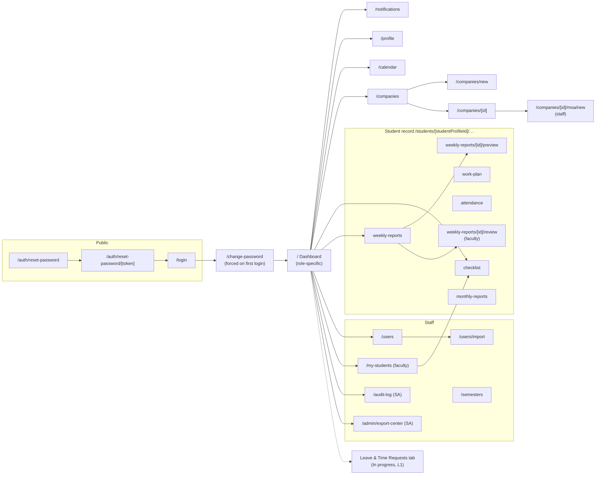

### 1.3 Screen inventory and states

| Screen                                    | Role(s)                              | Main states shown                                                                                                                                         |
| ----------------------------------------- | ------------------------------------ | --------------------------------------------------------------------------------------------------------------------------------------------------------- |
| `/login`                                  | Public                               | Default; error message for wrong password, locked account (with time), inactive account                                                                   |
| `/change-password`                        | Signed in                            | Forced ("Set a new password") or voluntary ("Change your password"); validation errors                                                                    |
| `/auth/reset-password`, `/[token]`        | Public                               | Request sent; invalid or expired link; new password set                                                                                                   |
| `/` (Dashboard)                           | All                                  | Student: "Needs attention" card only when something needs action; final report cover locked/unlocked. Staff: empty tables when no students; filters       |
| `/checklist` → `/students/{id}/checklist` | Student, staff                       | Per item Pending / Approved / Returned (with note); "Tracked automatically" for Work Plan and MOA; endorsement letter locked until 9/9, then downloadable |
| `/work-plan`                              | Student, staff                       | No plan; Submitted; Approved (locked); Returned with reviewer feedback; history                                                                           |
| `/attendance`                             | Student, staff                       | "The work schedule can be set once the work plan is approved"; schedule set; schedule change pending; pending hours line only when > 0                    |
| `/weekly-reports`                         | Student, staff                       | "No weekly reports yet"; Draft; "Submitted · awaiting review"; Returned; Approved / Regarded; PDF Generated / Failed (Regenerate)                         |
| `/weekly-reports/[id]/review`             | Faculty                              | Read-only report with late reason; four action buttons; Return needs a note                                                                               |
| `/monthly-reports`                        | Student, staff                       | "No weekly reports yet — monthly reports roll up approved weekly reports"; eligible month; submitted with PDF                                             |
| `/companies`, `/companies/[id]`           | All (MOA section staff only)         | "No companies found"; MOA list with status badges and allowed next statuses; verified flag                                                                |
| `/users`, `/users/import`                 | Coordinator, Super Admin             | Locked / inactive badges; import result with failed rows and a credentials download                                                                       |
| `/semesters`                              | Coordinator (read-only), Super Admin | "No semesters yet"; active; archived ("Read-only")                                                                                                        |
| `/audit-log`                              | Super Admin                          | "No matching entries"; filtered list                                                                                                                      |
| `/admin/export-center`                    | Super Admin                          | Export cards; inline password form; "No exports yet"; data requests with days left (overdue in red); retention flags                                      |
| `/notifications`                          | All                                  | Unread / read; empty                                                                                                                                      |
| `/profile`                                | All                                  | Legal name (students); "Your data" request open / none                                                                                                    |

## 2. User flows

### 2.1 Sign-in, password reset and lockout (Built)

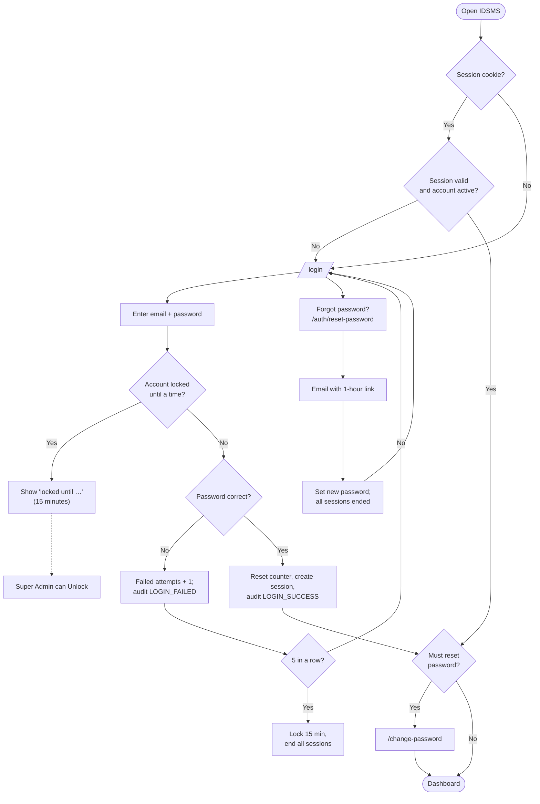

Notes: sessions expire after 30 minutes of inactivity. A reset does not lift a lock early.

### 2.2 Student (Built, with L1 changes marked)

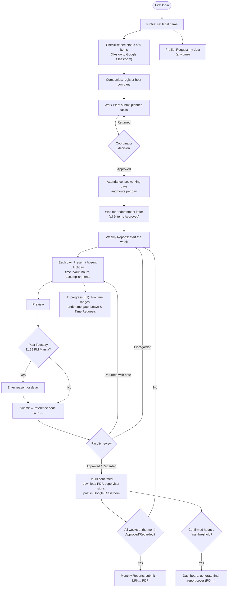

### 2.3 Faculty adviser (Built)

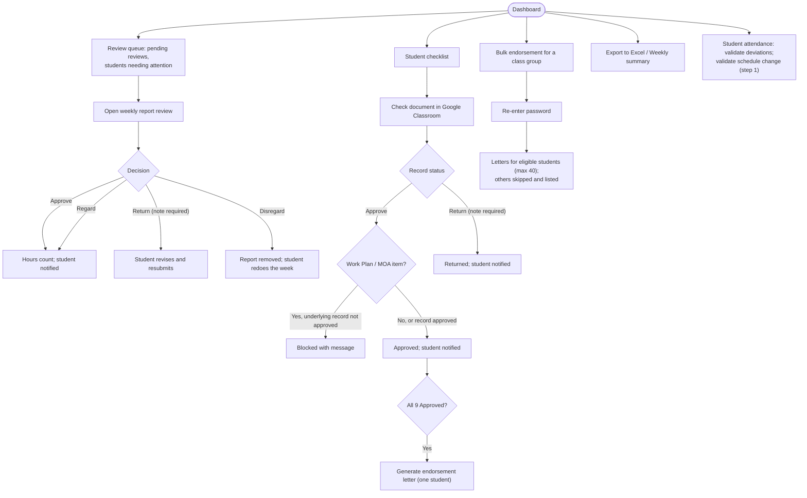

### 2.4 Coordinator (Built)

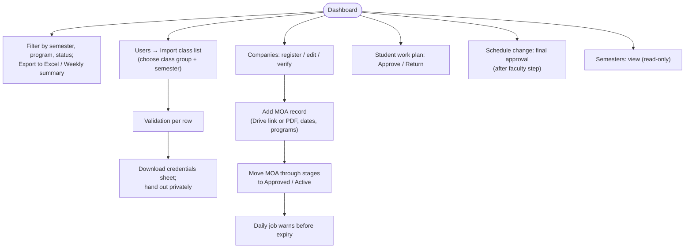

### 2.5 Super Admin (Built)

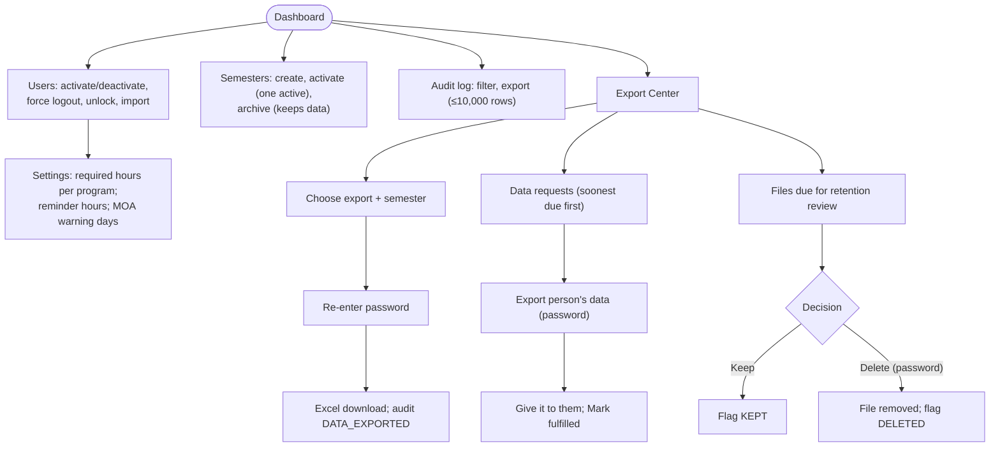

**Planned for the Super Admin and faculty:** class group & staff management screens (Q20), choosing required checklist items, the deduction matrix (L2).

## 3. State diagrams

### 3.1 Weekly report (Built)

The database enum `WeeklyReportStatus` has `PENDING, APPROVED, RETURNED, REGARDED, DISREGARDED`. "Draft" and "Submitted" are both stored as `PENDING`; the difference is the last lifecycle entry in `revisionHistory` (`SUBMITTED` or `RETURNED`). Dashboards display these derived states.

```mermaid
stateDiagram-v2
    [*] --> Draft: student starts the week<br/>(PENDING, no SUBMITTED entry)
    Draft --> Submitted: submit<br/>(PENDING + SUBMITTED entry,<br/>late flag, WR- code)
    Submitted --> Approved: faculty Approve
    Submitted --> Regarded: faculty Regard
    Submitted --> Returned: faculty Return (note)
    Submitted --> [*]: faculty Disregard<br/>(row deleted)
    Returned --> Submitted: student edits and resubmits
    Approved --> [*]
    Regarded --> [*]
    note right of Approved: Approved and Regarded are final;<br/>their hours are confirmed
```

### 3.2 Pre-deployment checklist item (Built, D7)

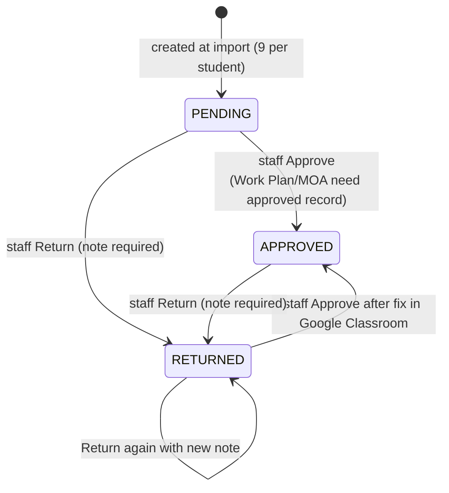

### 3.3 Work plan (Built)

```mermaid
stateDiagram-v2
    [*] --> SUBMITTED: student submits
    SUBMITTED --> APPROVED: coordinator/SA approve<br/>(locked; endorsement draft queued)
    SUBMITTED --> RETURNED: coordinator/SA return with comments
    RETURNED --> [*]: student submits a new work plan (new record)
    APPROVED --> [*]: changes need a new submission
```

Schedule changes are recorded inside the approved work plan (`scheduleChangeHistory`): `PENDING_FACULTY` → faculty approves (`PENDING_COORDINATOR`) or rejects → coordinator approves or rejects → `APPLIED` from then on.

### 3.4 MOA record (Built; `MoaStatus`, allow-list in `companyService.ts`)

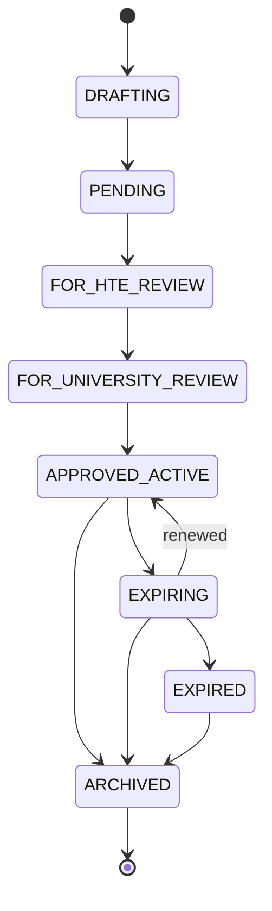

Status changes are made by staff. Only `APPROVED_ACTIVE` covering the student's program satisfies the checklist's MOA item.

### 3.5 Generated document (Built; `DocumentStatus`)

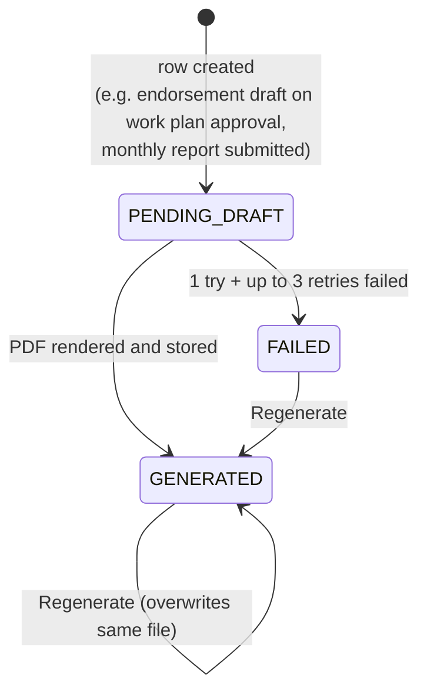

### 3.6 Data request (Built)

```mermaid
stateDiagram-v2
    [*] --> OPEN: user clicks Request my data<br/>(due in 15 days; one open per user)
    OPEN --> OPEN: daily reminders from 3 days before due
    OPEN --> FULFILLED: Super Admin exports and marks fulfilled
    FULFILLED --> [*]
```

### 3.7 Retention flag (Built)

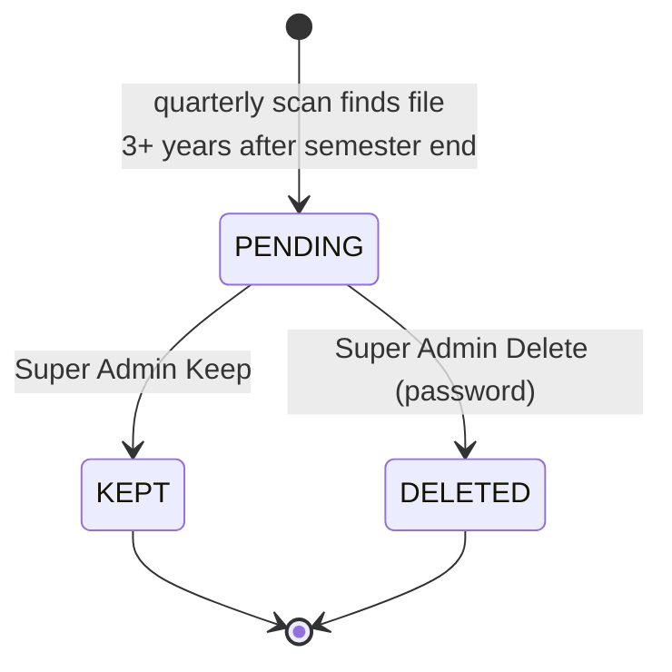

### 3.8 Semester (Built)

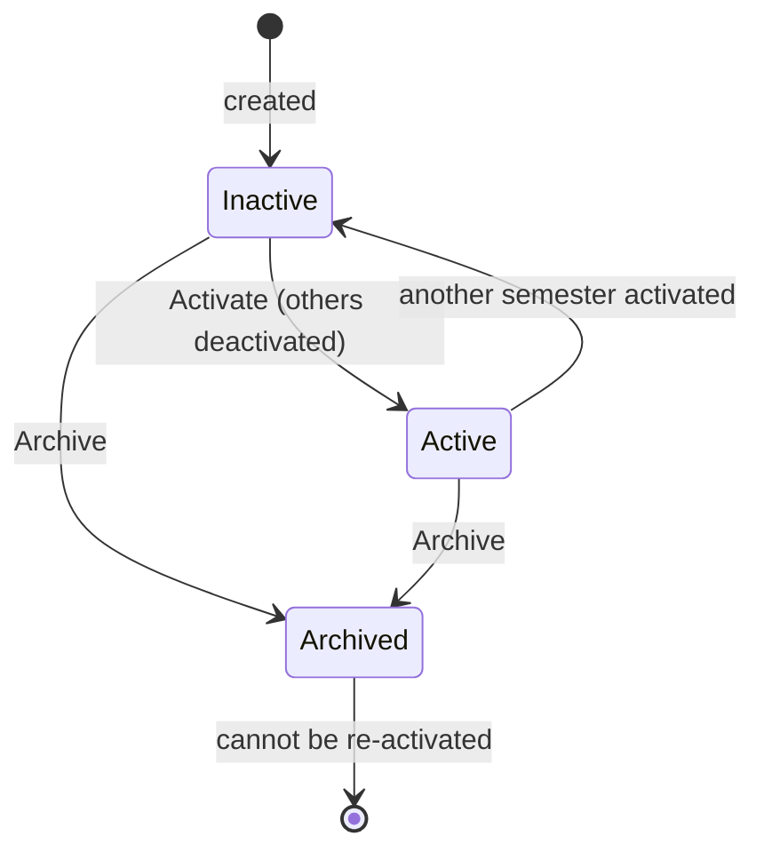

### 3.9 User account and lockout (Built)

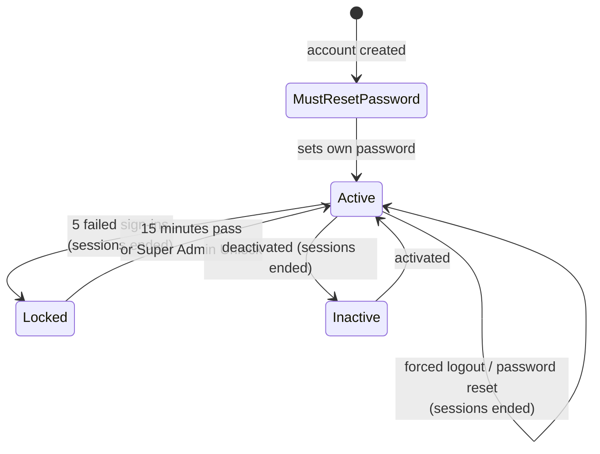

### 3.10 Time request (In progress, L1)

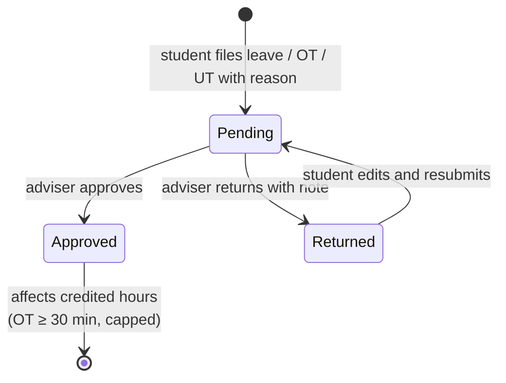

Stored as the existing `ValidationStatus` (`PENDING`, `VALIDATED`, `REJECTED`) shown as Pending / Approved / Returned.

### 3.11 Conduct record (Planned, L2)

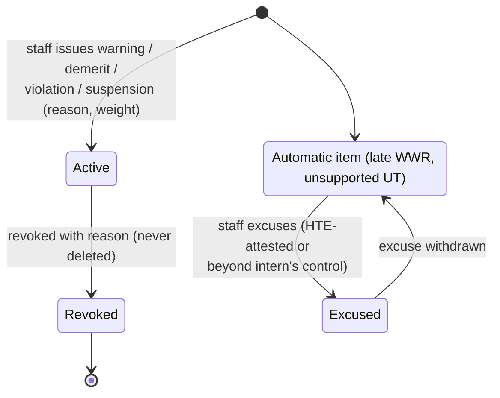

## 4. Key sequences

### 4.1 Weekly report: submit → review → hours → PDF (Built)

```mermaid
sequenceDiagram
    actor S as Student
    actor F as Faculty adviser
    participant API as API routes
    participant WR as weeklyReportService
    participant AT as attendanceService
    participant DOC as documentService
    participant DB as Postgres
    participant ST as Storage
    S->>API: POST /api/weekly-reports/{id}/submit (reasonForDelay?)
    API->>WR: validateLateSubmissionReason (Tuesday 23:59 Manila)
    API->>WR: generateReportReferenceCode (WR-…)
    WR->>DB: status PENDING + SUBMITTED entry (late flag); audit
    API-->>S: in-app notice to student and assigned faculty
    F->>API: PATCH /api/weekly-reports/{id}/review {action, notes}
    API->>API: requireRole FACULTY_ADVISER + assertCanAccessStudent
    API->>WR: Approve / Return / Regard / Disregard
    WR->>AT: recompute confirmed hours and projection (Approve/Regard)
    AT->>DB: student_profiles.rendered_hours
    API-->>S: notification (+ email if configured)
    S->>API: GET or POST /api/weekly-reports/{id}/pdf
    API->>DOC: renderAndStoreDocument (retry 1s/2s/4s)
    DOC->>ST: upload generated-documents/weekly/…
    DOC->>DB: generated_documents GENERATED or FAILED
    API-->>S: redirect to 5-minute signed URL
```

### 4.2 Endorsement letter: gate and re-authentication (Built)

```mermaid
sequenceDiagram
    actor F as Faculty / Coordinator
    participant API as API routes
    participant AUTH as confirmPassword
    participant CK as checklistService
    participant DOC as documentService
    participant N as notify
    F->>API: POST /api/class-groups/{id}/endorsement-letters {password}
    API->>API: requireRole; faculty must advise this class group
    API->>AUTH: verifyCredentials (failures count toward lockout)
    AUTH-->>API: ok / 401 / 423 locked
    loop each student (max 40)
        API->>CK: isEndorsementGateSatisfied (9/9 Approved)
        alt gate satisfied and legal name + company present
            API->>DOC: generateEndorsementLetterPdf (EL-…)
            DOC-->>API: GENERATED
            API->>N: ENDORSEMENT_LETTER_READY to student
        else not eligible
            API-->>F: listed as skipped with reason
        end
    end
```

A single-student letter (`POST /api/students/{id}/endorsement-letter`) runs the same gate without the password step.

### 4.3 Daily job (Built)

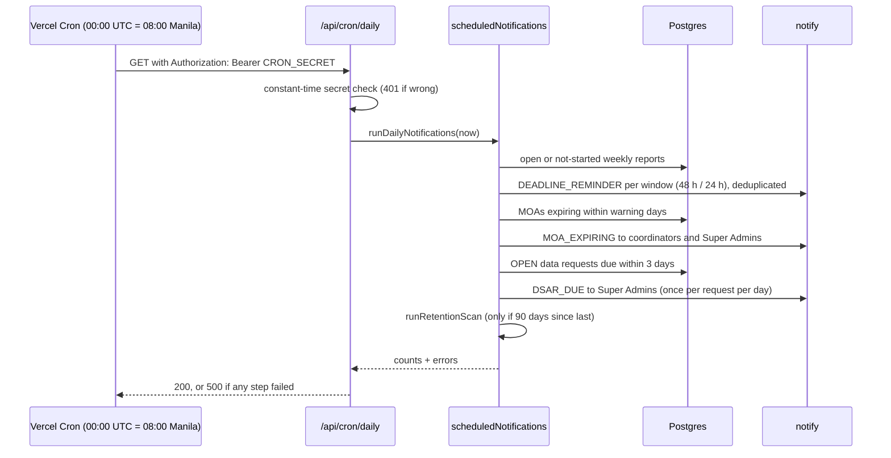

### 4.4 Export Center export (Built)

```mermaid
sequenceDiagram
    actor A as Super Admin
    participant UI as Export card (inline password form)
    participant API as POST /api/admin/exports/{kind}
    participant AUTH as confirmPassword
    participant EX as adminExportService
    participant AU as auditService
    A->>UI: choose export and semester, enter password
    UI->>API: {password, semesterId?}
    API->>API: requireRole SUPER_ADMIN; valid kind
    API->>AUTH: verifyCredentials
    alt wrong password or locked
        AUTH-->>UI: 401 / 423, message shown inline
    else ok
        API->>EX: buildAdminExport(kind) (no secrets, formula-safe)
        API->>AU: logEvent DATA_EXPORTED (append-only)
        API-->>UI: .xlsx download
    end
```

## 5. Where flows may change

These points rest on the PM's interpretation of SLU's instructions and are open to the adviser's revision ([11](11-decisions-and-open-questions.md)):

| Point                           | Current behaviour                              | Could change if…                                                                   | Question |
| ------------------------------- | ---------------------------------------------- | ---------------------------------------------------------------------------------- | -------- |
| Status-only checklist (D7)      | Files in Google Classroom; IDSMS tracks status | The adviser wants documents in IDSMS                                               | Q1       |
| Endorsement gate                | All 9 items must be Approved                   | Required/optional items are chosen                                                 | Q2       |
| Endorsement before MOA approval | Not possible                                   | A per-student override is added                                                    | Q4       |
| Who finalises hours             | Assigned faculty adviser only                  | A second confirmation is required                                                  | Q3       |
| Hours rules (L1)                | Student-entered hours in approved weeks        | SLU credited-hours rules ship (shift window, OT ≥ 30 min, no offsetting, no grace) | Q6       |
| Week numbering                  | No week numbers yet                            | "Week 1 starts" date per semester                                                  | Q8       |
| Deviation proof                 | Optional upload                                | Moves to Google Classroom with status only                                         | Q19      |
| Monthly report                  | Built from approved weeks                      | SLU monthly journal template                                                       | Q7       |
| Deductions                      | None                                           | SLU matrix (L2)                                                                    | Q9–Q12   |
| Class groups and staff accounts | No screens (database / API)                    | Screens for faculty or Super Admin                                                 | Q20      |
| Email                           | In-app only without a domain                   | Sending domain provided                                                            | Q15      |
| Hosting                         | Vercel + Supabase                              | Lab computer                                                                       | Q17      |
