# 14. Data schema

> Draft for adviser review — flows and rules may change; see [README](README.md).

_Last updated: 13 October 2026. Audience: IT office, maintainers; sections 1–3 are readable by non-developers. Status labels: **Built**, **In progress**, **Planned**._

This document describes the data IDSMS keeps behind the screens: every table, its fields and relations, the status values, the JSON fields, the database-level protections and the file storage layout. Sources: `prisma/schema.prisma` and `prisma/migrations_manual/001–007`. It contains no connection strings or keys.

## 1. Entity-relationship diagram

All primary keys are UUIDs. Column names in the database are snake_case (for example `student_profile_id`); the Prisma model fields are camelCase.

```mermaid
erDiagram
    users {
        uuid id PK
        string email UK
        string hashed_password
        Role role
        bool is_active
        bool must_reset_password
        int failed_login_attempts
        datetime locked_until
        datetime deleted_at
    }
    sessions {
        uuid id PK
        string session_token UK
        uuid user_id FK
        datetime expires
    }
    accounts {
        uuid id PK
        uuid user_id FK
        string provider
        string provider_account_id
    }
    password_reset_tokens {
        uuid id PK
        uuid user_id FK
        string token_hash UK
        datetime expires_at
        datetime used_at
    }
    student_profiles {
        uuid id PK
        uuid user_id FK,UK
        string student_number UK
        Program program
        uuid class_group_id FK
        uuid semester_id FK
        uuid company_id FK
        int required_hours
        decimal rendered_hours
        datetime internship_start_date
        string position_title
        string full_name
    }
    class_groups {
        uuid id PK
        string name
        Program program
        string class_type
        datetime start_date
        datetime end_date
    }
    faculty_class_groups {
        uuid id PK
        uuid faculty_id FK
        uuid class_group_id FK
        uuid semester_id FK
    }
    semesters {
        uuid id PK
        string name
        string academic_year
        datetime start_date
        datetime end_date
        bool is_active
        datetime archived_at
    }
    companies {
        uuid id PK
        string name
        string address
        WorkModality work_modality
        string supervisor_name
        string supervisor_contact
        string supervisor_position
        bool is_verified
    }
    moa_records {
        uuid id PK
        uuid company_id FK
        string document_url
        string document_path
        MoaStatus status
        datetime valid_from
        datetime valid_to
        Program[] programs_covered
    }
    pre_deployment_checklist_items {
        uuid id PK
        uuid student_profile_id FK
        ChecklistRequirementType requirement_type
        ChecklistStatus status
        uuid reviewer_id FK
        datetime review_date
        string comments
    }
    work_plans {
        uuid id PK
        uuid student_profile_id FK
        WorkPlanStatus status
        json planned_tasks
        json schedule_config
        json schedule_change_history
        json approval_metadata
        uuid coordinator_id FK
    }
    weekly_reports {
        uuid id PK
        uuid student_profile_id FK
        date week_start
        date week_end
        decimal total_hours
        WeeklyReportStatus status
        json revision_history
    }
    daily_report_entries {
        uuid id PK
        uuid weekly_report_id FK
        date report_date
        string attendance_status
        decimal scheduled_hours
        decimal actual_hours
        text accomplishments
        string time_in
        string time_out
    }
    deviation_reports {
        uuid id PK
        uuid student_profile_id FK
        date date
        DeviationType deviation_type
        string reason
        string proof_url
        ValidationStatus validation_status
        uuid faculty_id
    }
    generated_documents {
        uuid id PK
        uuid student_profile_id FK
        DocumentType document_type
        string file_url
        string reference_code UK
        string period_label
        DocumentStatus status
    }
    notifications {
        uuid id PK
        uuid user_id FK
        string trigger_type
        NotificationChannel channel
        NotificationStatus status
        json payload
        datetime read_at
    }
    audit_logs {
        uuid id PK
        uuid user_id FK
        string action
        string entity_type
        uuid entity_id
        string ip_address
        datetime timestamp
        json detail
    }
    data_requests {
        uuid id PK
        uuid user_id FK
        DataRequestStatus status
        datetime due_at
        uuid fulfilled_by FK
    }
    retention_flags {
        uuid id PK
        string bucket
        string object_path
        RetentionSource source_type
        uuid source_id
        uuid student_profile_id
        RetentionStatus status
    }
    holiday_calendar {
        uuid id PK
        date date
        string name
        HolidayType holiday_type
        uuid semester_id FK
        uuid student_profile_id FK
    }
    system_config {
        uuid id PK
        string config_key UK
        json config_value
        uuid updated_by
    }

    users ||--o{ sessions : has
    users ||--o{ accounts : has
    users ||--o{ password_reset_tokens : has
    users ||--o| student_profiles : "is (student)"
    users ||--o{ faculty_class_groups : advises
    users ||--o{ pre_deployment_checklist_items : reviews
    users ||--o{ work_plans : "coordinates"
    users ||--o{ notifications : receives
    users ||--o{ audit_logs : "acts in"
    users ||--o{ data_requests : "requests / fulfils"
    class_groups ||--o{ student_profiles : contains
    class_groups ||--o{ faculty_class_groups : "assigned in"
    semesters ||--o{ student_profiles : enrols
    semesters ||--o{ faculty_class_groups : scopes
    semesters ||--o{ holiday_calendar : has
    companies ||--o{ student_profiles : hosts
    companies ||--o{ moa_records : has
    student_profiles ||--o{ pre_deployment_checklist_items : has
    student_profiles ||--o{ work_plans : submits
    student_profiles ||--o{ weekly_reports : submits
    weekly_reports ||--o{ daily_report_entries : contains
    student_profiles ||--o{ deviation_reports : files
    student_profiles ||--o{ generated_documents : owns
    student_profiles ||--o{ holiday_calendar : overrides
```

`retention_flags` refers to its source record (checklist item, deviation report or generated document) and student by id, without database foreign keys, so a flag survives after the file is deleted. `deviation_reports.faculty_id` is likewise a plain id.

## 2. Tables

"Writes" lists who changes the data (through which service); "Read on" lists the main screens.

| Table                            | Purpose                                                   | Key columns and constraints                                                                                                                                                                                               | Writes                                                            | Read on                                      |
| -------------------------------- | --------------------------------------------------------- | ------------------------------------------------------------------------------------------------------------------------------------------------------------------------------------------------------------------------- | ----------------------------------------------------------------- | -------------------------------------------- |
| `users`                          | Login identity and account state                          | `email` unique; `role`; `is_active`; `must_reset_password` (default true); `failed_login_attempts`, `locked_until`; soft delete `deleted_at`                                                                              | Import, Super Admin actions, sign-in (`userService`)              | Users, Audit log, all pages (session)        |
| `sessions`                       | Database sessions (30 min)                                | `session_token` unique; cascade-deleted with the user                                                                                                                                                                     | Sign-in; revoked on lock, deactivate, force logout, reset         | Every request                                |
| `accounts`                       | NextAuth adapter table (unused by password sign-in)       | unique (`provider`, `provider_account_id`)                                                                                                                                                                                | —                                                                 | —                                            |
| `password_reset_tokens`          | 1-hour reset links                                        | only `token_hash` stored, unique; `used_at`                                                                                                                                                                               | Reset request/confirm                                             | Reset pages                                  |
| `student_profiles`               | One per student                                           | `user_id` unique; `student_number` unique; `program`; `class_group_id`, `semester_id`, `company_id`; `required_hours`; cached `rendered_hours` (6,2); `full_name` (legal name); indexes on `company_id`, `class_group_id` | Import; company link; profile name; hours recompute               | Dashboards, every student page, exports      |
| `class_groups`                   | A class (program, type, dates)                            | soft delete                                                                                                                                                                                                               | Database / project team (screens **Planned**, Q20)                | Import form, My Students, dashboards         |
| `faculty_class_groups`           | Faculty ↔ class group per semester; drives faculty access | unique (`faculty_id`, `class_group_id`, `semester_id`)                                                                                                                                                                    | Database / project team (screens **Planned**, Q20)                | Every faculty access check                   |
| `semesters`                      | Semester dates, active and archived                       | exactly one active (enforced in a locked transaction)                                                                                                                                                                     | Super Admin                                                       | Semesters, dashboard filters, exports        |
| `companies`                      | Host companies (HTEs)                                     | `work_modality`; `supervisor_position`; `is_verified`; soft delete                                                                                                                                                        | Any signed-in user creates; staff edit/verify                     | Companies, endorsement letter                |
| `moa_records`                    | MOA per company                                           | exactly one of `document_url` (Drive link) / `document_path` (stored PDF), checked by the validator; `status`; validity dates; `programs_covered[]`; index `company_id`                                                   | Faculty, coordinator, Super Admin                                 | Company page, checklist MOA gate, expiry job |
| `pre_deployment_checklist_items` | Checklist status per student and requirement              | unique (`student_profile_id`, `requirement_type`); `status`; reviewer, date, `comments`; legacy `file_path` (not written since D7)                                                                                        | Created at import; staff review                                   | Checklist, dashboards, exports               |
| `work_plans`                     | Work plan and schedule                                    | `status`; JSON fields (section 4); `coordinator_id`; indexes on student and coordinator                                                                                                                                   | Student submits; coordinator reviews; schedule config and changes | Work Plan, Attendance                        |
| `weekly_reports`                 | One per student per week                                  | unique (`student_profile_id`, `week_start`); totals; `status`; `revision_history`; reserved AI columns (`similarity_*`, `sentiment_*`, unused)                                                                            | Student; faculty review                                           | Weekly reports, review, dashboards, exports  |
| `daily_report_entries`           | One per scheduled day                                     | `attendance_status` (`SCHEDULED`, `PRESENT`, `ABSENT`, `HOLIDAY`); `scheduled_hours`, `actual_hours`; `time_in`/`time_out` "HH:MM" (DB check constraint, migration 005)                                                   | Student                                                           | Weekly form, PDFs, attendance export         |
| `deviation_reports`              | Absence / overtime / undertime reports                    | `deviation_type`; `reason`; optional `proof_url` (storage path); `validation_status`                                                                                                                                      | Student; staff validate                                           | Attendance, calendar                         |
| `generated_documents`            | PDF metadata                                              | `document_type`; `file_url` (storage path); `reference_code` unique; `period_label` ("2026-08-24" week or "2026-08" month); `status`                                                                                      | `documentService`, work plan approval (draft), monthly submit     | PDF buttons, checklist, dashboard            |
| `notifications`                  | In-app and email notifications                            | `trigger_type`; `channel`; `payload` (title, body, link, dedupe key); `read_at`; index (`user_id`, `channel`, `read_at`); partial unique dedupe index (006)                                                               | `notify` (events and daily job)                                   | Bell, Notifications                          |
| `audit_logs`                     | Append-only event log                                     | `action`, `entity_type`, `entity_id`, `ip_address`, `timestamp`, `detail`; **no UPDATE/DELETE/TRUNCATE** (007)                                                                                                            | `auditService.logEvent` only                                      | Audit log, exports                           |
| `data_requests`                  | DSAR tickets                                              | `status`; `due_at` = request + 15 days; one OPEN per user (partial unique index, 007); indexes (`status`, `due_at`), `user_id`                                                                                            | Any user creates; Super Admin fulfils                             | Profile, Export Center                       |
| `retention_flags`                | Files due for retention review                            | unique (`source_type`, `source_id`); `bucket`, `object_path`; `semester_end_date`; `status`; index `status`                                                                                                               | Retention scan; Super Admin keep/delete                           | Export Center                                |
| `holiday_calendar`               | PH holidays and per-student overrides                     | `holiday_type`; optional `semester_id`; optional `student_profile_id` (company-specific override)                                                                                                                         | Seed (`prisma/seed-holidays.ts`); students mark applicable        | Attendance, calendar, weekly form            |
| `system_config`                  | Settings as key/value JSON                                | `config_key` unique; `updated_by`                                                                                                                                                                                         | Super Admin settings; retention scan                              | Users page settings, jobs                    |

## 3. Enumerations

| Enum                       | Values and meaning                                                                                                                                                                                          |
| -------------------------- | ----------------------------------------------------------------------------------------------------------------------------------------------------------------------------------------------------------- |
| `Role`                     | `SUPER_ADMIN` system administrator; `DEPARTMENT_COORDINATOR` internship coordinator; `FACULTY_ADVISER` adviser of assigned class groups; `STUDENT_INTERN` student                                           |
| `Program`                  | `BSIT`, `BSCS`, `BMMA`                                                                                                                                                                                      |
| `WorkModality`             | `ON_SITE`, `WORK_FROM_HOME`, `HYBRID`                                                                                                                                                                       |
| `MoaStatus`                | `DRAFTING` → `PENDING` → `FOR_HTE_REVIEW` → `FOR_UNIVERSITY_REVIEW` → `APPROVED_ACTIVE` → `EXPIRING` → `EXPIRED`; `ARCHIVED` (see [13](13-app-flow.md) §3.4)                                                |
| `ChecklistRequirementType` | `MEDICAL_CERTIFICATE`, `PSYCHOLOGICAL_CLEARANCE`, `PARENT_CONSENT_UNDERTAKING`, `COMPANY_REPLY_FORM`, `DATA_PRIVACY_ORIENTATION`, `INTERNSHIP_ORIENTATION`, `GOVERNMENT_COMPANY_PERMIT`, `WORK_PLAN`, `MOA` |
| `ChecklistStatus`          | `PENDING` not yet reviewed; `APPROVED`; `RETURNED` (with note)                                                                                                                                              |
| `WorkPlanStatus`           | `SUBMITTED`, `APPROVED` (locked), `RETURNED`                                                                                                                                                                |
| `DeviationType`            | `ABSENCE`, `OVERTIME`, `UNDERTIME`                                                                                                                                                                          |
| `ValidationStatus`         | `PENDING`, `VALIDATED`, `REJECTED` (shown as Pending / Approved / Returned for L1 requests)                                                                                                                 |
| `WeeklyReportStatus`       | `PENDING` (draft or submitted; see `revision_history`), `APPROVED`, `RETURNED`, `REGARDED`, `DISREGARDED` (row is deleted, so this value is returned but not stored)                                        |
| `SentimentLabel`           | `POSITIVE`, `NEUTRAL`, `NEGATIVE` (reserved for the planned AI feature)                                                                                                                                     |
| `DocumentType`             | `ENDORSEMENT_LETTER`, `WEEKLY_REPORT`, `MONTHLY_REPORT`, `FINAL_REPORT_COVER`                                                                                                                               |
| `DocumentStatus`           | `PENDING_DRAFT` row exists, no PDF yet; `GENERATED`; `FAILED` (Regenerate offered)                                                                                                                          |
| `NotificationChannel`      | `EMAIL`, `IN_APP`                                                                                                                                                                                           |
| `NotificationStatus`       | `SENT`, `PENDING`, `FAILED`                                                                                                                                                                                 |
| `HolidayType`              | `NATIONAL`, `REGIONAL` ("University suspension" is backlog, Q14)                                                                                                                                            |
| `DataRequestStatus`        | `OPEN`, `FULFILLED`                                                                                                                                                                                         |
| `RetentionStatus`          | `PENDING` awaiting review; `KEPT`; `DELETED`                                                                                                                                                                |
| `RetentionSource`          | `CHECKLIST` (legacy files), `DEVIATION_PROOF`, `GENERATED_DOCUMENT`                                                                                                                                         |

## 4. JSON columns

| Column                               | Shape                                                                                                                                                                                                                                | Notes                                                                                                                 |
| ------------------------------------ | ------------------------------------------------------------------------------------------------------------------------------------------------------------------------------------------------------------------------------------ | --------------------------------------------------------------------------------------------------------------------- |
| `work_plans.planned_tasks`           | `[{ "description": "…" }, …]` (at least one)                                                                                                                                                                                         | Free text; no program matching (FR-WP-03 deferred)                                                                    |
| `work_plans.schedule_config`         | `{ "daysOfWeek": [1,2,3,4,5], "hoursPerDay": 8 }` (0 = Sunday, Manila weekdays)                                                                                                                                                      | L1 adds optional `startTime`, `endTime`, `breakMinutes` (no migration; **In progress**)                               |
| `work_plans.schedule_change_history` | Array of entries with `status` (`PENDING_FACULTY`, `FACULTY_APPROVED`/`FACULTY_REJECTED`, `PENDING_COORDINATOR`, `COORDINATOR_APPROVED`/`COORDINATOR_REJECTED`, `APPLIED`), timestamps, reason, approver ids, requested new schedule | FR-AT-11 audit of schedule changes                                                                                    |
| `work_plans.approval_metadata`       | `{ "reviewedAt": ISO time, "comments": "…" \| null }`                                                                                                                                                                                | Written on review                                                                                                     |
| `weekly_reports.revision_history`    | Array of entries. `SUBMITTED`: `timestamp`, `referenceCode`, `late`, `reasonForDelay`, `submittedBy`. `RETURNED`: `timestamp`, `facultyId`, `notes`                                                                                  | The last `SUBMITTED`/`RETURNED` entry decides "Draft" vs "Submitted"; the latest `SUBMITTED` holds the reference code |
| `notifications.payload`              | `{ title, body, link, dedupeKey? }`                                                                                                                                                                                                  | Links are restricted to internal paths                                                                                |
| `audit_logs.detail`                  | Event-specific details (for example `{ "referenceCode": "WR-…", "late": false }`)                                                                                                                                                    | Exported as text, truncated to 2,000 characters                                                                       |
| `system_config.config_value`         | Depends on the key (below)                                                                                                                                                                                                           | Validated when read; invalid values fall back to defaults or raise an error                                           |

**`system_config` keys**

| Key                                       | Value                                  | Default when unset                                                                |
| ----------------------------------------- | -------------------------------------- | --------------------------------------------------------------------------------- |
| `required_hours:BSIT` / `:BSCS` / `:BMMA` | Integer hours                          | 600 / 240 / 500                                                                   |
| `final_report_threshold:{PROGRAM}`        | Integer hours                          | BSIT 500; others ⌈5/6 × required hours⌉; never above the student's required hours |
| `notification:deadline_reminder_hours`    | Array of 1–3 distinct integers, 16–168 | `[48, 24]`                                                                        |
| `notification:moa_warning_days`           | Integer 1–180                          | 30                                                                                |
| `retention:last_scan_at`                  | ISO timestamp                          | none (scan runs)                                                                  |

## 5. Database-level protections

| Protection                                  | Where                                                      | What it does                                                                                                                                                                                          |
| ------------------------------------------- | ---------------------------------------------------------- | ----------------------------------------------------------------------------------------------------------------------------------------------------------------------------------------------------- |
| Default-deny RLS                            | 002 (all tables), 007 (`data_requests`, `retention_flags`) | Row Level Security on, no policies: the Supabase public/anon key can read nothing. The app connects as the owner role, which bypasses RLS, so real access control is in the application.              |
| Audit log RLS policies                      | 001                                                        | Forbid UPDATE/DELETE for API roles; defense in depth only (the owner role bypasses RLS).                                                                                                              |
| **Append-only triggers**                    | 007                                                        | `BEFORE UPDATE OR DELETE` (per row) and `BEFORE TRUNCATE` triggers on `audit_logs` raise an error for every role, including the owner. INSERT still works. Consequence: users cannot be hard-deleted. |
| Partial unique index: notification dedupe   | 006                                                        | One IN_APP notification per dedupe key, so overlapping cron runs cannot double-send.                                                                                                                  |
| Partial unique index: one open data request | 007                                                        | `UNIQUE (user_id) WHERE status = 'OPEN'`.                                                                                                                                                             |
| Check constraints on times                  | 005                                                        | `time_in` / `time_out` must be "HH:MM" (24-hour) or null.                                                                                                                                             |
| Unique constraints                          | schema                                                     | Email, student number, session token, reset token hash, reference code, one report per student-week, one checklist row per requirement, one faculty assignment per group-semester, config key.        |
| Semester lock                               | `semesterService`                                          | `SELECT … FOR UPDATE` so concurrent activations cannot leave two active semesters.                                                                                                                    |

**The db push + manual SQL rule.** Tables come from `npx prisma db push` (no Prisma migration history). Afterwards, run the manual SQL files in order (001–007); re-run at least 006 and 007 after any later `db push`, because `db push` may drop indexes it does not know about. Verification queries for the audit-log triggers are at the end of 007.

**Recommendations (not built).** Following Postgres best practice (index every foreign key used in lookups), consider indexes on `daily_report_entries.weekly_report_id`, `deviation_reports.student_profile_id`, `generated_documents.student_profile_id`, `student_profiles.semester_id`, `audit_logs (timestamp)` and `audit_logs (user_id)`. Volumes are small today; re-check with real data in Phase 5.

## 6. File storage

All buckets are private; files are served only through 5-minute signed links created by the app (`src/lib/storage.ts`). Size caps: PDF 5 MB, JPG/PNG 2 MB (also enforced as bucket limits).

| Bucket                | Contents                                                            | Path convention                                                                                                                                                                                     | Status                              |
| --------------------- | ------------------------------------------------------------------- | --------------------------------------------------------------------------------------------------------------------------------------------------------------------------------------------------- | ----------------------------------- |
| `checklist-documents` | Legacy checklist files (none written since D7) and deviation proofs | checklist: `{studentProfileId}/{requirementType}.{ext}`; deviation proofs: `deviations/{studentProfileId}/{random}.{ext}`                                                                           | Built; deviation proofs pending Q19 |
| `moa-documents`       | MOA PDFs (when not a Drive link)                                    | `{companyId}/{moaRecordId}.{ext}`                                                                                                                                                                   | Built; **Planned**: Drive link only |
| `generated-documents` | All generated PDFs                                                  | `weekly/{studentProfileId}/{weeklyReportId}.pdf`, `monthly/{studentProfileId}/{YYYY-MM}.pdf`, `endorsement/{studentProfileId}.pdf`, `final-cover/{studentProfileId}.pdf`; overwritten on regenerate | Built                               |

In Phase 5 the same buckets move to MinIO on the lab computer behind the same module.

## 7. Planned schema changes

| Change                                                                                                                                                                                                                      | Workstream                     | Status                                          |
| --------------------------------------------------------------------------------------------------------------------------------------------------------------------------------------------------------------------------- | ------------------------------ | ----------------------------------------------- |
| Migration 008: on `deviation_reports` add `request_kind` (ANTICIPATED / EMERGENCY), `end_date`, `start_time`, `end_time`, `requested_minutes`, `proof_type`, `submitted_at`, `review_note` (all nullable)                   | L1                             | **In progress** (applied only with the PM's OK) |
| `daily_report_entries.time_in2` / `time_out2` (afternoon range)                                                                                                                                                             | L1                             | **In progress**                                 |
| `semesters.week_one_start` (date)                                                                                                                                                                                           | L1                             | **In progress** (Q8)                            |
| `schedule_config` gains `startTime`, `endTime`, `breakMinutes` (JSON, no migration)                                                                                                                                         | L1                             | **In progress**                                 |
| `conduct_records` (category, weight, date, reason, issuer, optional hours, revoke fields), `deduction_exceptions` (excused items), `deduction_matrix` and `demerit:default_hours` config keys                               | L2                             | **Planned**                                     |
| Required/optional checklist items configuration; new requirement types (proof of corporate legitimacy, internship agreement); per-student endorsement override with reason; MOA Drive link only; company "foreign HTE" flag | Checklist & MOA settings       | **Planned**                                     |
| Screens for class groups, faculty assignments and staff accounts (uses existing tables)                                                                                                                                     | Class group & staff management | **Planned** (Q20)                               |
| Final technical report and HTE evaluation tables; certificate status                                                                                                                                                        | H                              | **Planned**                                     |
| AI columns already reserved on `weekly_reports`; embedding vector column on `daily_report_entries` via raw SQL                                                                                                              | D                              | **Planned**, optional                           |
