# 14. Data schema

> Draft for adviser review — flows and rules may change; see [README](README.md).

_Last updated: 12 November 2026. Audience: IT office, maintainers; sections 1–3 are readable by non-developers. Status labels: **Built**, **In progress**, **Planned**._

This document describes the data IDSMS keeps behind the screens: every table, its fields and relations, the status values, the JSON fields, the database-level protections and the file storage layout. Sources: `prisma/schema.prisma` and `prisma/migrations_manual/001–031`. It contains no connection strings or keys.

## 1. Entity-relationship diagram

All primary keys are UUIDs. Column names in the database are snake_case (for example `student_profile_id`); the Prisma model fields are camelCase.

```mermaid
erDiagram
    users {
        uuid id PK
        string email UK
        string hashed_password
        Role role
        string full_name
        bool is_active
        bool must_reset_password
        int failed_login_attempts
        datetime locked_until
        datetime privacy_consent_at
        bool ai_assist
        bool email_notifications
        datetime deleted_at
    }
    sessions {
        uuid id PK
        string session_token UK
        uuid user_id FK
        datetime expires
    }
    accounts {
        uuid id PK
        uuid user_id FK
        string provider
        string provider_account_id
    }
    password_reset_tokens {
        uuid id PK
        uuid user_id FK
        string token_hash UK
        datetime expires_at
        datetime used_at
    }
    student_profiles {
        uuid id PK
        uuid user_id FK,UK
        string student_number UK
        Program program
        uuid class_group_id FK
        uuid semester_id FK
        uuid company_id FK
        int required_hours
        decimal rendered_hours
        datetime internship_start_date
        string position_title
        string office
        string full_name
        bool start_before_moa_allowed
    }
    class_groups {
        uuid id PK
        string name
        Program program
        string class_type
        datetime start_date
        datetime end_date
    }
    faculty_class_groups {
        uuid id PK
        uuid faculty_id FK
        uuid class_group_id FK
        uuid semester_id FK
    }
    semesters {
        uuid id PK
        string name
        string academic_year
        datetime start_date
        datetime end_date
        bool is_active
        datetime archived_at
        date week_one_start
    }
    companies {
        uuid id PK
        string name
        string address
        WorkModality work_modality
        string supervisor_name
        string supervisor_contact
        string supervisor_position
        bool is_verified
        bool is_foreign
        string hte_reply
    }
    moa_records {
        uuid id PK
        uuid company_id FK
        string document_url
        string document_path
        MoaStatus status
        datetime valid_from
        datetime valid_to
        Program[] programs_covered
    }
    pre_deployment_checklist_items {
        uuid id PK
        uuid student_profile_id FK
        ChecklistRequirementType requirement_type
        ChecklistStatus status
        uuid reviewer_id FK
        datetime review_date
        string comments
        datetime uploaded_at
    }
    work_plans {
        uuid id PK
        uuid student_profile_id FK
        WorkPlanStatus status
        json planned_tasks
        string file_path
        json schedule_config
        json schedule_change_history
        json approval_metadata
        uuid coordinator_id FK
    }
    weekly_reports {
        uuid id PK
        uuid student_profile_id FK
        date week_start
        date week_end
        decimal total_hours
        WeeklyReportStatus status
        json revision_history
        json ai_hints
    }
    daily_report_entries {
        uuid id PK
        uuid weekly_report_id FK
        date report_date
        string attendance_status
        decimal scheduled_hours
        decimal actual_hours
        decimal credited_hours
        text accomplishments
        string tools_used
        string time_in
        string time_out
        string time_in_2
        string time_out_2
    }
    deviation_reports {
        uuid id PK
        uuid student_profile_id FK
        date date
        DeviationType deviation_type
        string reason
        string proof_url
        ValidationStatus validation_status
        uuid faculty_id
        RequestKind request_kind
        string review_note
    }
    generated_documents {
        uuid id PK
        uuid student_profile_id FK
        DocumentType document_type
        string file_url
        string reference_code UK
        string period_label
        DocumentStatus status
    }
    notifications {
        uuid id PK
        uuid user_id FK
        string trigger_type
        NotificationChannel channel
        NotificationStatus status
        json payload
        datetime read_at
    }
    audit_logs {
        uuid id PK
        uuid user_id FK
        string action
        string entity_type
        uuid entity_id
        string ip_address
        datetime timestamp
        json detail
    }
    data_requests {
        uuid id PK
        uuid user_id FK
        DataRequestStatus status
        datetime due_at
        uuid fulfilled_by FK
    }
    retention_flags {
        uuid id PK
        string bucket
        string object_path
        RetentionSource source_type
        uuid source_id
        uuid student_profile_id
        RetentionStatus status
    }
    holiday_calendar {
        uuid id PK
        date date
        string name
        HolidayType holiday_type
        uuid semester_id FK
        uuid student_profile_id FK
        uuid company_id FK
    }
    system_config {
        uuid id PK
        string config_key UK
        json config_value
        uuid updated_by
    }
    company_placements {
        uuid id PK
        uuid student_profile_id FK
        uuid company_id FK
        date started_on
        date ended_on
        string end_reason
    }
    company_visits {
        uuid id PK
        uuid company_id FK
        date visited_on
        uuid visited_by FK
        string mode
    }
    company_evaluations {
        uuid id PK
        uuid student_profile_id FK,UK
        uuid company_id FK
        int[] obligations
        int[] quality
    }
    learning_journals {
        uuid id PK
        uuid student_profile_id FK
        string month
        text narrative
    }
    final_technical_reports {
        uuid id PK
        uuid student_profile_id FK,UK
        FinalReportStatus status
        json sections
        json assessment
    }
    conduct_records {
        uuid id PK
        uuid student_profile_id FK
        string category_key
        int weight
        decimal hours_deducted
        datetime revoked_at
    }
    deduction_exceptions {
        uuid id PK
        uuid student_profile_id FK
        string item_type
        string item_key
        string reason_code
    }
    deduction_disputes {
        uuid id PK
        uuid student_profile_id FK
        string item_type
        string item_key
        string outcome
    }
    department_events {
        uuid id PK
        uuid semester_id FK
        date date
        string title
    }
    ai_feedback {
        uuid id PK
        string job
        string target_id
        uuid user_id FK
        bool correct
    }

    users ||--o{ sessions : has
    users ||--o{ accounts : has
    users ||--o{ password_reset_tokens : has
    users ||--o| student_profiles : "is (student)"
    users ||--o{ faculty_class_groups : advises
    users ||--o{ pre_deployment_checklist_items : reviews
    users ||--o{ work_plans : "coordinates"
    users ||--o{ notifications : receives
    users ||--o{ audit_logs : "acts in"
    users ||--o{ data_requests : "requests / fulfils"
    class_groups ||--o{ student_profiles : contains
    class_groups ||--o{ faculty_class_groups : "assigned in"
    semesters ||--o{ student_profiles : enrols
    semesters ||--o{ faculty_class_groups : scopes
    semesters ||--o{ holiday_calendar : has
    companies ||--o{ student_profiles : hosts
    companies ||--o{ moa_records : has
    student_profiles ||--o{ pre_deployment_checklist_items : has
    student_profiles ||--o{ work_plans : submits
    student_profiles ||--o{ weekly_reports : submits
    weekly_reports ||--o{ daily_report_entries : contains
    student_profiles ||--o{ deviation_reports : files
    student_profiles ||--o{ generated_documents : owns
    student_profiles ||--o{ holiday_calendar : overrides
    companies ||--o{ holiday_calendar : "days off"
    student_profiles ||--o{ company_placements : "placed via"
    companies ||--o{ company_placements : hosts
    companies ||--o{ company_visits : "visited in"
    users ||--o{ company_visits : visits
    student_profiles ||--o| company_evaluations : rates
    companies ||--o{ company_evaluations : "rated in"
    student_profiles ||--o{ learning_journals : writes
    student_profiles ||--o| final_technical_reports : writes
    student_profiles ||--o{ conduct_records : has
    student_profiles ||--o{ deduction_exceptions : has
    student_profiles ||--o{ deduction_disputes : files
    semesters ||--o{ department_events : has
    users ||--o{ ai_feedback : rates
```

`retention_flags` refers to its source record (checklist item, deviation report or generated document) and student by id, without database foreign keys, so a flag survives after the file is deleted. `deviation_reports.faculty_id` is likewise a plain id.

## 2. Tables

"Writes" lists who changes the data (through which service); "Read on" lists the main screens.

| Table                            | Purpose                                                                                             | Key columns and constraints                                                                                                                                                                                                                                                                                                                  | Writes                                                                                                  | Read on                                                            |
| -------------------------------- | --------------------------------------------------------------------------------------------------- | -------------------------------------------------------------------------------------------------------------------------------------------------------------------------------------------------------------------------------------------------------------------------------------------------------------------------------------------- | ------------------------------------------------------------------------------------------------------- | ------------------------------------------------------------------ |
| `users`                          | Login identity and account state                                                                    | `email` unique; `role`; `full_name` (display name, mainly for staff; 015); `is_active`; `must_reset_password` (default true); `failed_login_attempts`, `locked_until`; `privacy_consent_at`/`_version` (013); `ai_assist` (020) and `email_notifications` (031) switches, default true; soft delete `deleted_at`                             | Import, Super Admin actions, sign-in, account settings (`userService`)                                  | Users, Audit log, all pages (session)                              |
| `sessions`                       | Database sessions (30 min)                                                                          | `session_token` unique; cascade-deleted with the user                                                                                                                                                                                                                                                                                        | Sign-in; revoked on lock, deactivate, force logout, reset                                               | Every request                                                      |
| `accounts`                       | NextAuth adapter table (linked accounts when beta Google sign-in is on; unused by password sign-in) | unique (`provider`, `provider_account_id`)                                                                                                                                                                                                                                                                                                   | NextAuth adapter                                                                                        | —                                                                  |
| `password_reset_tokens`          | 1-hour reset links                                                                                  | only `token_hash` stored, unique; `used_at`                                                                                                                                                                                                                                                                                                  | Reset request/confirm                                                                                   | Reset pages                                                        |
| `student_profiles`               | One per student                                                                                     | `user_id` unique; `student_number` unique; `program`; `class_group_id`, `semester_id`, `company_id`; `required_hours`; cached `rendered_hours` (6,2); `office` (021); `full_name` (legal name); start-before-MOA override and reason (014); indexes on `company_id`, `class_group_id`, `semester_id`                                         | Import; company link; profile name; hours recompute                                                     | Dashboards, every student page, exports                            |
| `class_groups`                   | A class (program, type, dates)                                                                      | soft delete                                                                                                                                                                                                                                                                                                                                  | Coordinator, Super Admin (class group screens)                                                          | Import form, My Students, dashboards                               |
| `faculty_class_groups`           | Faculty ↔ class group per semester; drives faculty access                                           | unique (`faculty_id`, `class_group_id`, `semester_id`)                                                                                                                                                                                                                                                                                       | Coordinator, Super Admin (assign advisers, copy from another semester)                                  | Every faculty access check                                         |
| `semesters`                      | Semester dates, active and archived                                                                 | exactly one active (enforced in a locked transaction); `week_one_start` (008)                                                                                                                                                                                                                                                                | Super Admin                                                                                             | Semesters, dashboard filters, exports                              |
| `companies`                      | Host companies (HTEs)                                                                               | `work_modality`; `supervisor_position`; `is_verified`; `is_foreign` (outside PH, 014); `hte_reply`, `hte_reply_at`, `hte_reply_by` (019); trigram name matching (026); soft delete                                                                                                                                                           | Any signed-in user creates; staff edit, verify, merge                                                   | Companies, endorsement letter                                      |
| `moa_records`                    | MOA per company                                                                                     | exactly one of `document_url` (Drive link) / `document_path` (stored PDF), checked by the validator; `status`; validity dates; `programs_covered[]`; index `company_id`                                                                                                                                                                      | Faculty, coordinator, Super Admin                                                                       | Company page, checklist MOA gate, expiry job                       |
| `pre_deployment_checklist_items` | Checklist status per student and requirement                                                        | unique (`student_profile_id`, `requirement_type`); `status`; reviewer, date, `comments`; `uploaded_at` (the intern says it is on Classroom, 027); legacy `file_path` (not written since D7)                                                                                                                                                  | Created at import; intern marks uploaded; staff review (one or in bulk)                                 | Checklist, review queue, dashboards, exports                       |
| `work_plans`                     | Work plan and schedule                                                                              | `status`; JSON fields (section 4); `file_path` (uploaded PDF, 024); `coordinator_id`; indexes on student and coordinator                                                                                                                                                                                                                     | Student submits; coordinator reviews; schedule config and changes                                       | Work Plan, Attendance                                              |
| `weekly_reports`                 | One per student per week                                                                            | unique (`student_profile_id`, `week_start`); totals; `status`; `revision_history`; AI columns (`similarity_*`, `sentiment_*`, `ai_processed_at`) and `ai_hints` (020)                                                                                                                                                                        | Student; faculty review; nightly AI job                                                                 | Weekly reports, review, dashboards, exports                        |
| `daily_report_entries`           | One per scheduled day                                                                               | `attendance_status` (`SCHEDULED` until the intern saves the day, then `PRESENT`, `ABSENT` or `HOLIDAY`); `scheduled_hours`, `actual_hours`, `credited_hours` (008); `tools_used`; `time_in`/`time_out` and `time_in_2`/`time_out_2` "HH:MM" (DB check constraints, 005 and 008); index `weekly_report_id`                                    | Student                                                                                                 | Weekly form, PDFs, attendance export                               |
| `deviation_reports`              | Absence / overtime / undertime records                                                              | `deviation_type`; `reason`; request columns (008: `request_kind`, `end_date`, `start_time`, `end_time`, `requested_minutes`, `proof_type`, `submitted_at`, `review_note`); optional `proof_url` (a Google Drive or Classroom link; old rows may hold a storage path); `validation_status`; index (`student_profile_id`, `validation_status`) | Weekly report (review note "Reported in the weekly report"); requests filed the old way; adviser review | Weekly review, Overtime/undertime & absences, attendance, calendar |
| `generated_documents`            | PDF metadata                                                                                        | `document_type`; `file_url` (storage path); `reference_code` unique; `period_label` ("2026-08-24" week or "2026-08" month); `status`; index `student_profile_id`                                                                                                                                                                             | `documentService`, work plan approval (draft), monthly submit                                           | PDF buttons, checklist, dashboard                                  |
| `notifications`                  | In-app and email notifications                                                                      | `trigger_type`; `channel`; `payload` (title, body, link, dedupe key); `read_at`; index (`user_id`, `channel`, `read_at`); partial unique dedupe index (006)                                                                                                                                                                                  | `notify` (events and daily job)                                                                         | Bell, Notifications                                                |
| `audit_logs`                     | Append-only event log                                                                               | `action`, `entity_type`, `entity_id`, `ip_address`, `timestamp`, `detail`; **no UPDATE/DELETE/TRUNCATE** (007)                                                                                                                                                                                                                               | `auditService.logEvent` only                                                                            | Audit log, exports                                                 |
| `data_requests`                  | DSAR tickets                                                                                        | `status`; `due_at` = request + 15 days; one OPEN per user (partial unique index, 007); indexes (`status`, `due_at`), `user_id`                                                                                                                                                                                                               | Any user creates; Super Admin fulfils                                                                   | Profile, Export Center                                             |
| `retention_flags`                | Files due for retention review                                                                      | unique (`source_type`, `source_id`); `bucket`, `object_path`; `semester_end_date`; `status`; index `status`                                                                                                                                                                                                                                  | Retention scan; Super Admin keep/delete                                                                 | Export Center                                                      |
| `holiday_calendar`               | PH holidays, company days off and per-student overrides                                             | `holiday_type`; optional `semester_id`; optional `student_profile_id` (the intern's opt-out marker); optional `company_id` (a host company's own day off, 017); `created_by`                                                                                                                                                                 | Seed (`prisma/seed-holidays.ts`); coordinator (company days); students mark applicable                  | Attendance, calendar, weekly form                                  |
| `system_config`                  | Settings as key/value JSON                                                                          | `config_key` unique; `updated_by`                                                                                                                                                                                                                                                                                                            | Coordinator and Super Admin settings; retention scan; AI jobs                                           | Settings pages, jobs                                               |
| `company_placements`             | An intern's placement at a host company, from joining to leaving (025)                              | `student_profile_id`, `company_id`; `started_on`, `ended_on`; `end_reason` (RETRACTED / COMPLETED); retraction fields (last day, reason, filed, noted by); indexes on student, company and noter                                                                                                                                             | Joining a company; retraction notice; coordinator notes it                                              | Company page, intern profile                                       |
| `company_visits`                 | Company visits and supervisor check-ins (025)                                                       | `company_id`; `visited_on`; `visited_by`; `mode` (`ON_SITE`, `CALL`, `ONLINE`); `notes`                                                                                                                                                                                                                                                      | Faculty, coordinator, Super Admin                                                                       | Company page                                                       |
| `company_evaluations`            | The intern's FM-VAA-052 evaluation of the host company (019, 022)                                   | `student_profile_id` unique; `company_id`; `obligations[]` (16) and `quality[]` (6), each 1–4; `liked`, `improve`, `comment`                                                                                                                                                                                                                 | Intern, once all required hours are confirmed                                                           | Company page (facts and ratings at 5+ interns), PDF                |
| `learning_journals`              | Journal on Learning Experience, one per intern per month (021)                                      | unique (`student_profile_id`, `month` "YYYY-MM"); `narrative`                                                                                                                                                                                                                                                                                | Intern                                                                                                  | Monthly reports, PDFs                                              |
| `final_technical_reports`        | The final technical report (010, 023)                                                               | `student_profile_id` unique; `status` (`FinalReportStatus`); `sections`, `assessment`, `attachments` JSON; supervisor and peer scores; review fields                                                                                                                                                                                         | Intern writes and submits; coordinator or Super Admin reviews                                           | Final report, PDF                                                  |
| `conduct_records`                | Warnings, demerits, violations, suspensions (009)                                                   | `category_key`; `weight`; `date`; `reason`; `hours_deducted`; `issued_by_id`; revoke fields; index `student_profile_id`                                                                                                                                                                                                                      | Staff issue and revoke                                                                                  | Deductions, attendance                                             |
| `deduction_exceptions`           | Excused deduction items (009)                                                                       | `item_type` (`LATE_WWR`, `MISSING_WWR`, `UNSUPPORTED_UT`); `item_key`; `reason_code`; `note`; withdraw fields                                                                                                                                                                                                                                | Staff excuse and withdraw                                                                               | Deductions                                                         |
| `deduction_disputes`             | An intern's dispute of a deduction (018)                                                            | `item_type` (also `CONDUCT`); `item_key`; `reason`; `outcome` (ACCEPTED / DECLINED) and `resolution_note`; one open dispute per item (partial unique index)                                                                                                                                                                                  | Intern files; staff accept (excuse or revoke) or decline                                                | Deductions                                                         |
| `department_events`              | Events the coordinator posts for a semester (030)                                                   | `semester_id`; `date`; `title`; `created_by`; index (`semester_id`, `date`); no effect on hours                                                                                                                                                                                                                                              | Coordinator, Super Admin                                                                                | Every calendar in the semester                                     |
| `ai_feedback`                    | Staff's Correct / Not right ratings of AI hints (020)                                               | unique (`job`, `target_id`, `user_id`); `correct`                                                                                                                                                                                                                                                                                            | Faculty, coordinator, Super Admin                                                                       | AI settings (hint confidence), job switch-off                      |

## 3. Enumerations

| Enum                       | Values and meaning                                                                                                                                                                                                                                                   |
| -------------------------- | -------------------------------------------------------------------------------------------------------------------------------------------------------------------------------------------------------------------------------------------------------------------- |
| `Role`                     | `SUPER_ADMIN` system administrator; `DEPARTMENT_COORDINATOR` internship coordinator; `FACULTY_ADVISER` adviser of assigned class groups; `STUDENT_INTERN` student                                                                                                    |
| `Program`                  | `BSIT`, `BSCS`, `BMMA`                                                                                                                                                                                                                                               |
| `WorkModality`             | `ON_SITE`, `WORK_FROM_HOME`, `HYBRID`                                                                                                                                                                                                                                |
| `MoaStatus`                | `DRAFTING` → `PENDING` → `FOR_HTE_REVIEW` → `FOR_UNIVERSITY_REVIEW` → `APPROVED_ACTIVE` → `EXPIRING` → `EXPIRED`; `ARCHIVED` (see [13](13-app-flow.md) §3.4)                                                                                                         |
| `ChecklistRequirementType` | `MEDICAL_CERTIFICATE`, `PSYCHOLOGICAL_CLEARANCE`, `PARENT_CONSENT_UNDERTAKING`, `COMPANY_REPLY_FORM`, `DATA_PRIVACY_ORIENTATION`, `INTERNSHIP_ORIENTATION`, `GOVERNMENT_COMPANY_PERMIT`, `WORK_PLAN`, `MOA`, `PROOF_OF_CORPORATE_LEGITIMACY`, `INTERNSHIP_AGREEMENT` |
| `ChecklistStatus`          | `PENDING` not yet reviewed; `APPROVED`; `RETURNED` (with note)                                                                                                                                                                                                       |
| `WorkPlanStatus`           | `SUBMITTED`, `APPROVED` (locked), `RETURNED`                                                                                                                                                                                                                         |
| `DeviationType`            | `ABSENCE`, `OVERTIME`, `UNDERTIME`                                                                                                                                                                                                                                   |
| `RequestKind`              | `ANTICIPATED`, `EMERGENCY`                                                                                                                                                                                                                                           |
| `ProofType`                | `MEDICAL_CERTIFICATE`, `PROOF_OF_LEAVE`, `WRITTEN_NOTICE`                                                                                                                                                                                                            |
| `ValidationStatus`         | `PENDING`, `VALIDATED`, `REJECTED` (shown as Pending / Approved / Returned; rows reported in the weekly report are decided in the week's review)                                                                                                                     |
| `WeeklyReportStatus`       | `PENDING` (draft or submitted; see `revision_history`), `APPROVED`, `RETURNED`, `REGARDED`, `DISREGARDED` (row is deleted, so this value is returned but not stored)                                                                                                 |
| `SentimentLabel`           | `POSITIVE`, `NEUTRAL`, `NEGATIVE` (AI tone hint, advisory only)                                                                                                                                                                                                      |
| `DocumentType`             | `ENDORSEMENT_LETTER`, `WEEKLY_REPORT`, `MONTHLY_REPORT`, `FINAL_REPORT_COVER`, `FINAL_TECHNICAL_REPORT`                                                                                                                                                              |
| `DocumentStatus`           | `PENDING_DRAFT` row exists, no PDF yet; `GENERATED`; `FAILED` (Regenerate offered)                                                                                                                                                                                   |
| `NotificationChannel`      | `EMAIL`, `IN_APP`                                                                                                                                                                                                                                                    |
| `NotificationStatus`       | `SENT`, `PENDING`, `FAILED`                                                                                                                                                                                                                                          |
| `FinalReportStatus`        | `DRAFT`, `SUBMITTED`, `APPROVED`, `RETURNED`                                                                                                                                                                                                                         |
| `HolidayType`              | `NATIONAL`, `REGIONAL`, `COMPANY` (a host company's day off, 017), `SUSPENSION` (029; in the enum but not written: interns follow their host company's days off, recorded as `COMPANY`)                                                                              |
| `DataRequestStatus`        | `OPEN`, `FULFILLED`                                                                                                                                                                                                                                                  |
| `RetentionStatus`          | `PENDING` awaiting review; `KEPT`; `DELETED`                                                                                                                                                                                                                         |
| `RetentionSource`          | `CHECKLIST` (legacy files), `DEVIATION_PROOF`, `GENERATED_DOCUMENT`                                                                                                                                                                                                  |

## 4. JSON columns

| Column                               | Shape                                                                                                                                                                                                                                | Notes                                                                                                                 |
| ------------------------------------ | ------------------------------------------------------------------------------------------------------------------------------------------------------------------------------------------------------------------------------------ | --------------------------------------------------------------------------------------------------------------------- |
| `work_plans.planned_tasks`           | `[{ "description": "…" }, …]` (at least one)                                                                                                                                                                                         | Free text; checked against the program's keywords as advice (FR-WP-03)                                                |
| `work_plans.schedule_config`         | `{ "daysOfWeek": [1,2,3,4,5], "hoursPerDay": 8 }` (0 = Sunday, Manila weekdays)                                                                                                                                                      | L1 adds optional `startTime`, `endTime`, `breakMinutes` (no migration; **Built**, #87)                                |
| `work_plans.schedule_change_history` | Array of entries with `status` (`PENDING_FACULTY`, `FACULTY_APPROVED`/`FACULTY_REJECTED`, `PENDING_COORDINATOR`, `COORDINATOR_APPROVED`/`COORDINATOR_REJECTED`, `APPLIED`), timestamps, reason, approver ids, requested new schedule | FR-AT-11 audit of schedule changes                                                                                    |
| `work_plans.approval_metadata`       | `{ "reviewedAt": ISO time, "comments": "…" \| null }`                                                                                                                                                                                | Written on review                                                                                                     |
| `weekly_reports.revision_history`    | Array of entries. `SUBMITTED`: `timestamp`, `referenceCode`, `late`, `reasonForDelay`, `submittedBy`. `RETURNED`: `timestamp`, `facultyId`, `notes`                                                                                  | The last `SUBMITTED`/`RETURNED` entry decides "Draft" vs "Submitted"; the latest `SUBMITTED` holds the reference code |
| `notifications.payload`              | `{ title, body, link, dedupeKey? }`                                                                                                                                                                                                  | Links are restricted to internal paths                                                                                |
| `audit_logs.detail`                  | Event-specific details (for example `{ "referenceCode": "WR-…", "late": false }`)                                                                                                                                                    | Exported as text, truncated to 2,000 characters                                                                       |
| `system_config.config_value`         | Depends on the key (below)                                                                                                                                                                                                           | Validated when read; invalid values fall back to defaults or raise an error                                           |

**`system_config` keys**

| Key                                                                                   | Value                                                                          | Default when unset                                                                |
| ------------------------------------------------------------------------------------- | ------------------------------------------------------------------------------ | --------------------------------------------------------------------------------- |
| `required_hours:BSIT` / `:BSCS` / `:BMMA`                                             | Integer hours                                                                  | 600 / 320 / 500                                                                   |
| `final_report_threshold:{PROGRAM}`                                                    | Integer hours                                                                  | BSIT 500; others ⌈5/6 × required hours⌉; never above the student's required hours |
| `notification:deadline_reminder_hours`                                                | Array of 1–3 distinct integers, 16–168                                         | `[48, 24]`                                                                        |
| `notification:moa_warning_days`                                                       | Integer 1–180                                                                  | 30                                                                                |
| `retention:last_scan_at`                                                              | ISO timestamp                                                                  | none (scan runs)                                                                  |
| `checklist.requiredItems`                                                             | Array of requirement types that must be approved before the endorsement letter | the built-in required set                                                         |
| `deduction_matrix`                                                                    | SLU deduction matrix (categories and tiers)                                    | built-in matrix (`src/lib/utils/deductionMatrix.ts`)                              |
| `conduct:default_hours`                                                               | Default hours deducted per conduct record                                      | built-in default                                                                  |
| `faculty_submission_threshold`                                                        | Submissions per week that mark a high-volume week on the faculty calendar      | 20                                                                                |
| `maintenance_notice`                                                                  | The maintenance banner message                                                 | none (no banner)                                                                  |
| `ai:*` (`ai:enabled`, `ai:connections`, `ai:similarity_threshold`, `ai:job_state`, …) | AI assist settings and job state                                               | AI off                                                                            |

## 5. Database-level protections

| Protection                                  | Where                                                      | What it does                                                                                                                                                                                          |
| ------------------------------------------- | ---------------------------------------------------------- | ----------------------------------------------------------------------------------------------------------------------------------------------------------------------------------------------------- |
| Default-deny RLS                            | 002 (all tables), 007 (`data_requests`, `retention_flags`) | Row Level Security on, no policies: the Supabase public/anon key can read nothing. The app connects as the owner role, which bypasses RLS, so real access control is in the application.              |
| Audit log RLS policies                      | 001                                                        | Forbid UPDATE/DELETE for API roles; defense in depth only (the owner role bypasses RLS).                                                                                                              |
| **Append-only triggers**                    | 007                                                        | `BEFORE UPDATE OR DELETE` (per row) and `BEFORE TRUNCATE` triggers on `audit_logs` raise an error for every role, including the owner. INSERT still works. Consequence: users cannot be hard-deleted. |
| Partial unique index: notification dedupe   | 006                                                        | One IN_APP notification per dedupe key, so overlapping cron runs cannot double-send.                                                                                                                  |
| Partial unique index: one open data request | 007                                                        | `UNIQUE (user_id) WHERE status = 'OPEN'`.                                                                                                                                                             |
| Check constraints on times                  | 005, 008                                                   | `time_in` / `time_out` and `time_in_2` / `time_out_2` must be "HH:MM" (24-hour) or null.                                                                                                              |
| Unique constraints                          | schema                                                     | Email, student number, session token, reset token hash, reference code, one report per student-week, one checklist row per requirement, one faculty assignment per group-semester, config key.        |
| Semester lock                               | `semesterService`                                          | `SELECT … FOR UPDATE` so concurrent activations cannot leave two active semesters.                                                                                                                    |

**The db push + manual SQL rule.** Tables come from `npx prisma db push` (no Prisma migration history). Afterwards, run the manual SQL files in order (001–031); re-run them after any later `db push`, because `db push` may drop indexes it does not know about (006, 007, 012, 018, 028). Verification queries for the audit-log triggers are at the end of 007.

**Foreign-key indexes.** Migrations 012 and 028 index every foreign key used in lookups, and the schema declares the main ones (`daily_report_entries.weekly_report_id`, `deviation_reports (student_profile_id, validation_status)`, `generated_documents.student_profile_id`, `student_profiles.semester_id`).

## 6. File storage

All buckets are private; files are served only through 5-minute signed links created by the app (`src/lib/storage.ts`). Size caps: PDF 5 MB, JPG/PNG 2 MB (also enforced as bucket limits).

| Bucket                | Contents                                                                                                    | Path convention                                                                                                                                                                                                                            | Status                                               |
| --------------------- | ----------------------------------------------------------------------------------------------------------- | ------------------------------------------------------------------------------------------------------------------------------------------------------------------------------------------------------------------------------------------ | ---------------------------------------------------- |
| `checklist-documents` | Uploaded work plan PDFs; legacy checklist files and legacy deviation proofs (none written since D7 and Q19) | work plans: `work-plans/{studentProfileId}/{uuid}.pdf`; legacy checklist: `{studentProfileId}/{requirementType}.{ext}`; legacy proofs: `deviations/{studentProfileId}/{random}.{ext}`                                                      | Built; new proof is a Google Drive or Classroom link |
| `moa-documents`       | MOA PDFs (when not a Drive link)                                                                            | `{companyId}/{moaRecordId}.{ext}`                                                                                                                                                                                                          | Built; new MOAs use a Drive link only (#105)         |
| `generated-documents` | All generated PDFs                                                                                          | `weekly/{studentProfileId}/{weeklyReportId}.pdf`, `monthly/{studentProfileId}/{YYYY-MM}.pdf`, `endorsement/{studentProfileId}.pdf`, `final-cover/{studentProfileId}.pdf`, `final-report/{studentProfileId}.pdf`; overwritten on regenerate | Built                                                |

In Phase 5 the same buckets move to MinIO on the lab computer behind the same module.

## 7. Schema changes added in Phase 4

| Change                                                                                                                                                                                                                                                                                         | Workstream                     | Status                                                  |
| ---------------------------------------------------------------------------------------------------------------------------------------------------------------------------------------------------------------------------------------------------------------------------------------------- | ------------------------------ | ------------------------------------------------------- |
| Migration 008: on `deviation_reports` add `request_kind` (ANTICIPATED / EMERGENCY), `end_date`, `start_time`, `end_time`, `requested_minutes`, `proof_type`, `submitted_at`, `review_note` (all nullable)                                                                                      | L1                             | **Built** (#87)                                         |
| `daily_report_entries.time_in_2` / `time_out_2` (afternoon range)                                                                                                                                                                                                                              | L1                             | **Built** (#87)                                         |
| `semesters.week_one_start` (date)                                                                                                                                                                                                                                                              | L1                             | **Built** (#87)                                         |
| `schedule_config` gains `startTime`, `endTime`, `breakMinutes` (JSON, no migration)                                                                                                                                                                                                            | L1                             | **Built** (#87)                                         |
| `conduct_records` (category, weight, date, reason, issuer, optional hours, revoke fields), `deduction_exceptions` (excused items), `deduction_disputes` (intern disputes and outcomes, migration 018), `deduction_matrix` and `conduct:default_hours` config keys                              | L2                             | **Built** (#88)                                         |
| `company_evaluations` (one per intern, migration 019; since 022 the FM-VAA-052 form: 16 obligations and 6 quality items rated 1–4, comments A–C); `companies.hte_reply`, `hte_reply_at`, `hte_reply_by` (the company's reply). Staff see facts and ratings only once 5 interns are behind them | Company view                   | **Built**                                               |
| Required/optional checklist items configuration; new requirement types (proof of corporate legitimacy, internship agreement); per-student endorsement override with reason; MOA Drive link only; company "foreign HTE" flag                                                                    | Checklist & MOA settings       | **Built** (#105)                                        |
| Screens for class groups, faculty assignments and staff accounts (uses existing tables)                                                                                                                                                                                                        | Class group & staff management | **Built** (#100)                                        |
| Final technical report and HTE evaluation tables; certificate status                                                                                                                                                                                                                           | H                              | **Built** (#89)                                         |
| AI columns on `weekly_reports` (plus `ai_hints`, `users.ai_assist`, `ai_feedback`, migration 020); embedding vector column on `daily_report_entries` via raw SQL                                                                                                                               | D                              | **Built** (#90, #155); on for the beta, per-user switch |
| `users.full_name` (staff display name)                                                                                                                                                                                                                                                         | Identity                       | **Built** (migration 015, #109)                         |
